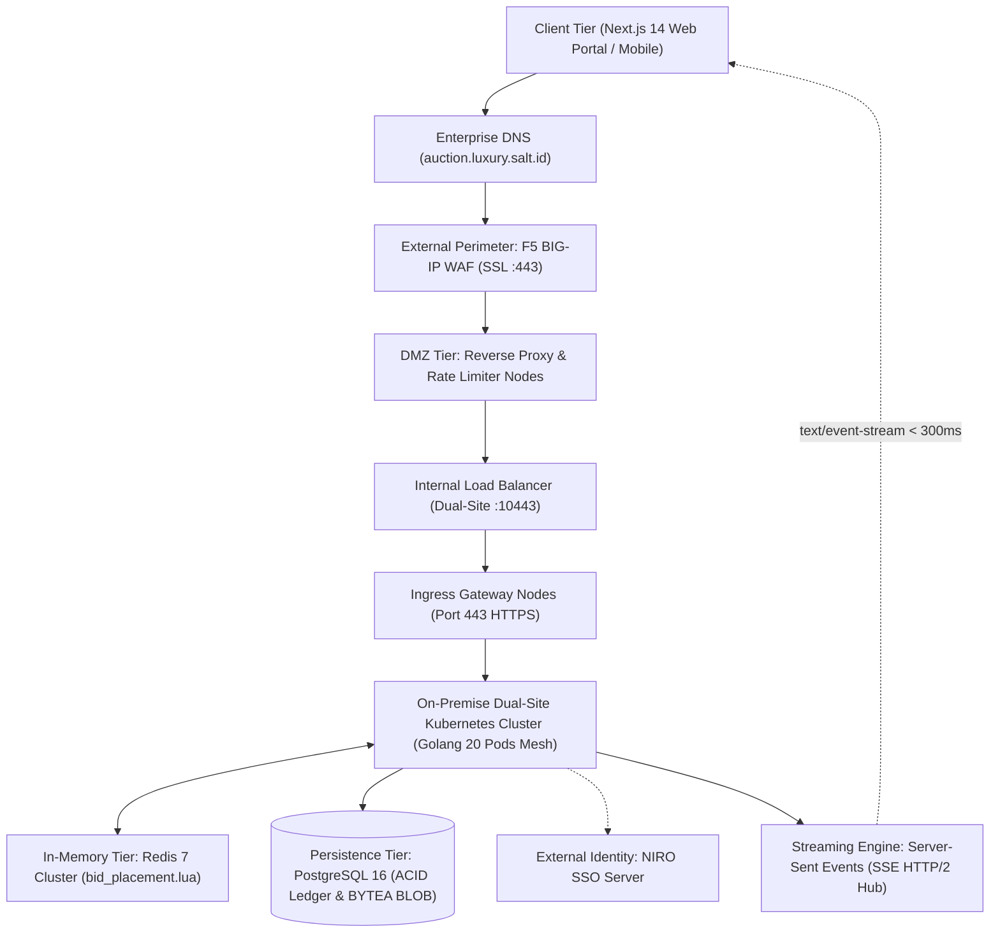
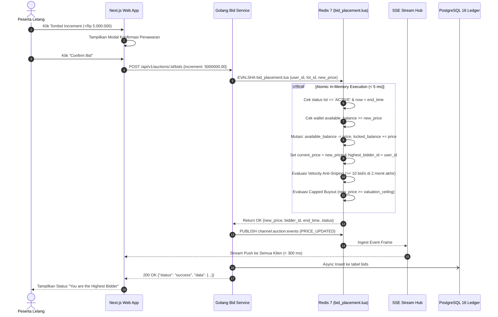

# SOFTWARE REQUIREMENT SPECIFICATION (SRS)
## Real-Time Luxury Auction Engine
### High-Performance Real-Time Bidding & Financial Collateral Platform

| Metadata | Value |
|---|---|
| **Document Code** | SRS-SALT-AUCTION-2026-v1.0 |
| **Prepared By** | System Analyst & Solution Architecture Team |
| **Date** | 24 Oct 2026 |
| **Version** | 1.0 (Approved Baseline) |
| **Organization** | PT Ako Media Asia (SALT) |
| **Confidentiality** | Strictly Confidential @2026 PT Ako Media Asia (SALT) |

---

## 1. Introduction

### 1.1 Background & Context
Lelang barang mewah (*luxury assets*) seperti jam tangan antik, tas desainer, perhiasan murni, kendaraan koleksi, dan memorabilia langka menuntut transparansi, kepastian dana transaksi (*anti-fraud*), serta keadilan penawaran waktu-nyata (*sub-second synchronization*). Selama ini, platform lelang konvensional kerap menghadapi kendala penipuan penawaran palsu (*fake bids*), *sniping bot* pada detik-detik akhir penutupan, pembatalan sepihak saat lelang berakhir, dan tingginya *network lag* pada arsitektur HTTP polling tradisional.

### 1.2 Business Objective & Expected Outcome
Platform **Real-Time Luxury Auction Engine** dibangun untuk menghadirkan ekosistem lelang aset bernilai tinggi dengan objektif:
1. **Verifikasi Kredensial & Identitas Terpercaya:** Mengintegrasikan otentikasi korporat **NIRO SSO** bagi penawar dan manajer lelang, serta portal internal terisolasi dengan proteksi *progressive lockout* bagi Superadmin.
2. **Dynamic Collateral Protection (Jaminan Dana Nyata):** Setiap penawaran yang diajukan langsung mengunci saldo penawar (*locked balance*) secara dinamis di dompet digital. Dana ini tetap tertahan sepanjang lelang berlangsung hingga tahap *settlement* akhir guna memastikan likuiditas penuh.
3. **Pencegahan Bot & Kesalahan Input:** Menghilangkan form input teks bebas dengan menerapkan tombol inkremental bertingkat (*discrete increment step buttons*) yang telah ditentukan kurator.
4. **Anti-Sniping Berbasis Lonjakan Velositas:** Otomatis memperpanjang waktu lelang jika terdeteksi aktivitas penawaran $\ge 10\text{ bid/detik}$ dalam jendela 2 menit terakhir penutupan lelang.
5. **Streaming Real-Time Berlatensi Rendah:** Mengadopsi teknologi **Server-Sent Events (SSE)** yang ramah *firewall* WAF untuk menyiarkan pembaruan harga ke ribuan pengguna secara serentak dengan latensi $< 300\text{ ms}$.

### 1.3 Scope of the System
* **In-Scope (MVP 1):**
  - Dual-login (NIRO SSO & Internal Superadmin dengan progressive lockout).
  - Manajemen Role-Based Access Control (Bidder, Auction Manager, Superadmin).
  - Manajemen Dompet Agunan Dinamis (Top-up minimum Rp 100.000, penahanan dana lelang, unfreeze otomatis 100% bagi peserta kalah, debit bagi pemenang).
  - Kurasi Listing Lot Lelang Barang Mewah (5 kategori, upload gambar biner multipart disimpan di PostgreSQL BLOB `BYTEA`).
  - Dual-Model Bidding (Uncapped Time-Window vs Capped Valuation Ceiling Buy-Out).
  - Penawaran tombol diskrit, bot penawar otomatis (*Automated Proxy Bidding*).
  - Anti-Sniping velocity detection & dynamic time extension.
  - Background Settlement Daemon berbasis Redis ZSET & distributed lock ACID.
  - Streaming telemetri penawaran via Server-Sent Events (SSE).
* **Out-of-Scope (MVP 1):**
  - Pembayaran eksternal kartu kredit pihak ketiga atau cicilan PayLater.
  - Pengiriman fisik multi-ekspedisi logistik (hanya sampai pencatatan *asset ownership* legal).
  - Fitur *Forgot Password* dan *Multi-device Session Kickout* (ditiadakan sesuai kesepakatan).

---

## 2. Overview

### 2.1 Document Purpose
Dokumen *Software Requirement Specification* (SRS) ini merinci seluruh persyaratan fungsional, arsitektural, antarmuka pengguna, kontrak API, serta kebutuhan non-fungsional sistem lelang barang mewah. Dokumen ini berfungsi sebagai acuan tunggal yang mengikat bagi Project Manager, Tech Lead, System Analyst, Tim Frontend Next.js, Tim Backend Golang, serta Quality Assurance.

### 2.2 Target Audience
- **Delivery & Project Management:** Acuan milestone sprint, pelacakan task, dan *story sizing*.
- **System Analyst & Solution Architect:** Verifikasi kepatuhan prinsip arsitektur dan DDD.
- **Frontend Engineers (Next.js):** Acuan *UI slicing*, *state management*, interaksi SSE EventSource, dan form validation.
- **Backend Engineers (Golang):** Acuan *Clean Architecture*, *raw SQL* 70%, skrip Redis Lua, dan standard JSON response envelope.
- **QA Engineers:** Acuan penyusunan skenario pengujian TDD dan uji konkurensi $10.000\text{ req/s}$.

### 2.3 Document References
1. **Brief & Guideline Hackathon 2026:** [PDF Brief](file:///C:/Users/Daniel/.gemini/antigravity/brain/bd980ca4-23ee-44a3-a5ed-230fd0690b42/.user_uploaded/media_1792812187986_0083b4e8.pdf)
2. **High-Level Design (HLD):** [`high-level-design.md`](file:///d:/Projects/Salt-Hackaton-2026/02_Projects/real-time-auction-engine/04_Design/high-level-design.md)
3. **Low-Level Design (LLD):** [`lld-low-level-design.md`](file:///d:/Projects/Salt-Hackaton-2026/02_Projects/real-time-auction-engine/04_Design/lld-low-level-design.md)
4. **API Contracts Specification:** [`api-contracts.md`](file:///d:/Projects/Salt-Hackaton-2026/02_Projects/real-time-auction-engine/05_Integration/api-contracts.md)
5. **Database Schema & DDL:** [`database-schema.md`](file:///d:/Projects/Salt-Hackaton-2026/02_Projects/real-time-auction-engine/06_Data_Design/database-schema.md)
6. **Backend Coding Standards:** [`backend-coding-standards.md`](file:///d:/Projects/Salt-Hackaton-2026/05_Methodologies/backend-coding-standards.md)
7. **Task Breakdown & Sizing:** [`Real_Time_Auction_Engine_Task_Breakdown_Sizing.xlsx`](file:///d:/Projects/Salt-Hackaton-2026/08_Project_Management/Task_Breakdown/Real_Time_Auction_Engine_Task_Breakdown_Sizing.xlsx)

### 2.4 Terms & Definitions (Glossaries)
| No | Istilah | Kepanjangan | Definisi Operasional |
|:---:|---|---|---|
| 1 | **NIRO SSO** | NIRO Single Sign-On | Penyedia identitas terpusat OAuth2/OIDC untuk otentikasi Bidder dan Auction Manager. |
| 2 | **SSE** | Server-Sent Events | Protokol streaming data satu arah dari server ke klien via persistent HTTP `text/event-stream`. |
| 3 | **BLOB** | Binary Large Object | Tipe data `BYTEA` PostgreSQL untuk menyimpan konten biner gambar barang mewah di database. |
| 4 | **Locked Balance** | Saldo Agunan Tertahan | Porsi saldo e-wallet penawar yang dikunci saat mengajukan penawaran dan tidak dapat ditarik selama lelang aktif. |
| 5 | **Anti-Sniping** | Anti-Sniping Engine | Logika otomasi perpanjangan durasi lot jika terjadi lonjakan velositas penawaran $\ge 10\text{ bid/s}$ di 2 menit akhir. |
| 6 | **Buy-Out** | Instant Buy-Out | Mekanisme pembelian langsung pada lelang *Capped* ketika tawaran menyentuh batas valuasi lelang. |
| 7 | **Proxy Bidding** | Automated Proxy Bidding | Bot penawar otomatis yang mewakili pengguna menaikkan harga 1 step increment setiap kali tersalip hingga batas maksimal personal. |

---

## 3. Functional Requirement

### 3.1 High-Level Functional Diagram

```mermaid
flowchart TD
    subgraph Users ["Actors & Identity"]
        Bidder["Bidder (Peserta)"]
        AM["Auction Manager (Kurator)"]
        Super["Superadmin Platform"]
    end

    subgraph Auth_Module ["Module 1: Authentication & Access Control"]
        NiroAuth["NIRO SSO Gateway & Auto-Provisioning"]
        EmailAuth["Superadmin Bcrypt & Progressive Lockout"]
        RoleMgmt["Role Promotion & Session Revocation (Auto-Logout)"]
    end

    subgraph Wallet_Module ["Module 2: Dynamic Collateral E-Wallet"]
        TopUp["Deposit Saldo (Min Rp 100.000)"]
        HoldFund["Dynamic Hold Allocation (locked_balance)"]
        ReleaseFund["Final Settlement Reconciliation (Debit/Release)"]
    end

    subgraph Catalog_Module ["Module 3: Luxury Lot Catalog & Curation"]
        CreateLot["Listing Lot & Binary Upload (Postgres BYTEA)"]
        PricingRules["Model Setup (Uncapped vs Capped & Steps)"]
        MarketGrid["Marketplace Query with Pagination & Badges"]
    end

    subgraph Bidding_Module ["Module 4: Real-Time Bidding & Lua Engine"]
        StepBid["Discrete Increment Step Button Execution"]
        ProxyBot["Autonomous Proxy Bidding Loop"]
        AntiSnipe["Velocity Surge Tracker (>= 10 bid/s in 2m window)"]
        Buyout["Instant Buyout Ceiling Resolver"]
    end

    subgraph Streaming_Module ["Module 5: Telemetry & Streaming Hub"]
        SSEHub["Server-Sent Events Broadcast Hub (< 300 ms)"]
    end

    Bidder --> NiroAuth
    AM --> NiroAuth
    Super --> EmailAuth

    Bidder --> TopUp
    Bidder --> StepBid
    Bidder --> ProxyBot
    AM --> CreateLot
    Super --> RoleMgmt

    StepBid --> HoldFund
    StepBid --> AntiSnipe
    StepBid --> Buyout
    StepBid --> SSEHub

    PricingRules --> CreateLot
    ReleaseFund --> Wallet_Module
```

### 3.2 Use Case Specifications & Actor Matrix

| Use Case ID | User Story Ref | Nama Fitur / Modul | Aktor Utama | Total AC | Story Size | Deskripsi Fungsional & Prekondisi |
|---|---|---|---|:---:|:---:|---|
| **UC-AUTH-01** | **US-AUTH** | Dual Authentication & Progressive Lockout | Bidder, AM, Superadmin | 8 | **M (155)** | Login NIRO SSO untuk Bidder/AM; Email/Pass min. 12 char + progressive lockout (1m/2m/1h) untuk Superadmin; Promosi role trigger auto-logout. |
| **UC-WAL-01** | **US-001** | E-Wallet Top-Up Journey (Step 1-3) | Bidder Exclusive | 9 | **M (115)** | Validasi min. Rp 100.000, kelipatan rupiah utuh, pemilihan channel VA/E-wallet, timer sesi kedaluwarsa, dan isolasi akses non-Bidder. |
| **UC-BID-01** | **US-002** | Dynamic Collateral Hold During Bidding | Bidder Exclusive | 4 | **M (175)** | Validasi ketersediaan saldo likuid; saldo dipindahkan ke locked balance saat menawar dan TETAP TERTAHAN selama lelang berlangsung. |
| **UC-BID-02** | **US-003** | Incremental Discrete Bidding & Modal Confirm | Bidder Exclusive | 8 | **M (170)** | Penawaran menggunakan tombol bertingkat (+Rp 5m/+Rp 10m) tanpa free-text typing, pop-up konfirmasi, dan serialisasi Redis Lua < 5 ms. |
| **UC-BID-03** | **US-004** | Velocity-Based Anti-Sniping Extension | Bidder, AM | 3 | **M (115)** | Deteksi intensitas lonjakan penawaran ($\ge$ 10 hits/s) pada jendela 2 menit akhir untuk memicu perpanjangan waktu dinamis otomatis. |
| **UC-BID-04** | **US-005** | Instant Buy-Out on Capped Valuation | Bidder Exclusive | 3 | **M (115)** | Penyelesaian lelang seketika jika penawar menekan tombol Instant Buy-Out atau mencapai ceiling valuation pada model lelang Capped. |
| **UC-BID-05** | **US-006** | Autonomous Proxy Bidding Worker | Bidder Exclusive | 4 | **M (130)** | Bot penawar otomatis yang mengevaluasi outbid event via Redis stream dan melakukan counter-bid hingga batas limit maksimal. |
| **UC-LOT-01** | **US-007** | Auction Lot Creation, Rule Form & BLOB | AM Exclusive | 11 | **M (115)** | Formulir kurasi lot lelang: input identitas, upload foto biner ke PostgreSQL BYTEA, live preview, pricing rules, dan anti-sniping selector. |
| **UC-STR-01** | **US-008** | Universal Live Bid & Concurrency Stream | Universal | 6 | **M (140)** | Sinkronisasi mutasi harga, countdown timer, dan indikator status via Server-Sent Events (SSE) dengan latensi $< 300\text{ ms}$. |
| **UC-SET-01** | **US-009** | Automated Settlement & Reconciliation Queue | AM, Daemon | 6 | **M (200)** | Background daemon 1s mengeksekusi settlement ACID: debet pemenang, rilis agunan peserta kalah 100%, serta resolusi exception short-payment. |
| **UC-CAT-01** | **US-010** | Marketplace Catalog & Filtering | Universal | 12 | **M (165)** | Galeri katalog barang bernilai tinggi: kategori, pagination, thumbnail Base64, dan filter dinamis sesuai status lelang. |
| **UC-HST-01** | **US-011** | Participant Bid History & Settlement Detail | Bidder Exclusive | 10 | **M (140)** | Dashboard riwayat penawaran: active bids, leading, outbid, won, progress tracker lelang tertutup, dan invoice settlement drawer. |
| **UC-DTL-01** | **US-012** | Product Detail Page & Live Room SSE | Universal | 9 | **M (110)** | Halaman detail lot: Base64 image, authenticity guarantee, chart riwayat harga lelang, tabs menu, dan banner proteksi koneksi terputus. |
| **UC-OVR-01** | **US-013** | Operations & Market Overview Dashboard | Universal | 6 | **S (90)** | Ringkasan metrik makro: Live sync indicator pill, 4 kartu saldo & status bid, watchlist slider ending soon, dan timeline recent activity. |
| **UC-LTM-01** | **US-014** | Lot Management Catalog Lifecycle Matrix | AM Exclusive | 8 | **S (65)** | Manajemen siklus hidup lot: 5 lifecycle tabs (Draft, Scheduled, Active, Closed, Archived), aksi View/Edit/Archive, dan toast notifikasi. |
| **UC-MON-01** | **US-015** | Live Auction Monitor & Authorized Interventions | AM Exclusive | 7 | **M (140)** | Pemantauan operasional mendalam: incoming bid acceleration, unique bidders, p95 latency gateway, serta intervensi (Pause, Flag, Cancel). |
| **UC-DIR-01** | **US-016** | Participants Directory & Compliance KYC | AM Exclusive | 6 | **M (140)** | Direktori peserta lelang: 4 metrik verifikasi, saldo agunan aktif, export data CSV/XLSX, dan kontrol verifikasi KYC. |

### 3.2.1 Story Sizing Appraisal & Complexity Matrix
Berikut adalah ringkasan hasil kalkulasi bobot estimasi (*Story Sizing Appraisal*) untuk seluruh 17 modul User Story berdasarkan formula parameter standar (*New Technology*, *# Surrounding Involvement*, *Technical Flow Sequences*, *Acceptance Criteria Count*, dan *UI Slicing Complexity*):

| Story ID | User Story Title | New Tech (15%) | Surrounding (15%) | Tech Flow (30%) | AC Count (25%) | UI Slicing (15%) | Total Score | Final Size | Story Point (APPS) |
|:---|:---|:---:|:---:|:---:|:---:|:---:|:---:|:---:|:---:|
| **US-AUTH** | Multi-Role Auth & Progressive Lockout | 15 (1) | 30 (2) | 60 (2) | 50 (2) | 0 (0) | **155** | **M** | 2.5 |
| **US-001** | E-Wallet Top-Up Journey (Step 1-3) | 15 (1) | 15 (1) | 60 (2) | 25 (1) | 0 (0) | **115** | **M** | 2.5 |
| **US-002** | Dynamic Collateral Hold During Bidding | 45 (3) | 15 (1) | 90 (3) | 25 (1) | 0 (0) | **175** | **M** | 2.5 |
| **US-003** | Incremental Bid on Uncapped Auction | 15 (1) | 15 (1) | 90 (3) | 50 (2) | 0 (0) | **170** | **M** | 2.5 |
| **US-004** | Velocity-Based Anti-Sniping Extension | 15 (1) | 15 (1) | 60 (2) | 25 (1) | 0 (0) | **115** | **M** | 2.5 |
| **US-005** | Instant Buy-Out on Capped Valuation | 15 (1) | 15 (1) | 60 (2) | 25 (1) | 0 (0) | **115** | **M** | 2.5 |
| **US-006** | Automated Proxy Bidding Bot | 0 (0) | 15 (1) | 90 (3) | 25 (1) | 0 (0) | **130** | **M** | 2.5 |
| **US-007** | Lot Creation, Rules & Form Layout | 15 (1) | 15 (1) | 60 (2) | 25 (1) | 0 (0) | **115** | **M** | 2.5 |
| **US-008** | Universal Live Bid & Concurrency Stream | 15 (1) | 15 (1) | 60 (2) | 50 (2) | 0 (0) | **140** | **M** | 2.5 |
| **US-009** | Settlement & Collateral Reconciliation | 15 (1) | 15 (1) | 120 (4) | 50 (2) | 0 (0) | **200** | **M** | 2.5 |
| **US-010** | View Item Marketplace & Catalog | 15 (1) | 15 (1) | 60 (2) | 75 (3) | 0 (0) | **165** | **M** | 2.5 |
| **US-011** | Participant Bid History & Settlement | 15 (1) | 15 (1) | 60 (2) | 50 (2) | 0 (0) | **140** | **M** | 2.5 |
| **US-012** | Product Detail & Live Room SSE | 15 (1) | 15 (1) | 30 (1) | 50 (2) | 0 (0) | **110** | **M** | 2.5 |
| **US-013** | Operations & Market Overview | 0 (0) | 15 (1) | 0 (0) | 75 (3) | 0 (0) | **90** | **S** | 2.5 |
| **US-014** | Lot Management Catalog Lifecycle | 0 (0) | 15 (1) | 0 (0) | 50 (2) | 0 (0) | **65** | **S** | 2.5 |
| **US-015** | Live Auction Monitor & Interventions | 15 (1) | 15 (1) | 60 (2) | 50 (2) | 0 (0) | **140** | **M** | 2.5 |
| **US-016** | Participants Directory & Compliance | 15 (1) | 15 (1) | 60 (2) | 50 (2) | 0 (0) | **140** | **M** | 2.5 |

### 3.3 Detailed User Flow (Core Scenarios)
1. **Alur Login & Auto-Provisioning NIRO:**
   `FE Request Redirect URL` $\rightarrow$ `User Login di NIRO` $\rightarrow$ `FE Terima niro_token` $\rightarrow$ `POST /api/v1/auth/login/niro` $\rightarrow$ `BE Validasi ke NIRO` $\rightarrow$ `Cek DB users`:
   - Jika belum ada: Insert user (role `BIDDER`) + Buat dompet saldo 0 $\rightarrow$ Return 201 Created.
   - Jika sudah ada: Ambil data user & role terkini $\rightarrow$ Return 200 OK.
2. **Alur Penawaran Atomik Hot-Path (Inkremental):**
   `Bidder Klik Tombol (+Rp 5.000.000)` $\rightarrow$ `Modal Konfirmasi Muncul` $\rightarrow$ `Bidder Klik Confirm` $\rightarrow$ `POST /api/v1/auctions/:id/bids` $\rightarrow$ `Redis Lua bid_placement.lua`:
   - Validasi saldo `available_balance >= target_bid`.
   - Kurangi `available_balance`, pindahkan ke `locked_balance`.
   - Update `current_price` dan `highest_bidder_id`.
   - Cek Anti-Sniping: jika sisa waktu $\le 120\text{s}$ dan velositas $\ge 10\text{ bid/s}$, tambahkan `end_time = end_time + extend_minutes`.
   - Cek Buy-Out: jika `new_price >= valuation_ceiling`, ubah status lot jadi `CLOSED_AWARDED`.
   - Terbitkan pesan event ke Redis Pub/Sub $\rightarrow$ Didistribusikan oleh SSE Hub ke seluruh klien dalam $< 300\text{ ms}$.

### 3.4 Business Rules Inventory (BR-XXX)
* **BR-001 (Otentikasi Ganda):** Bidder dan Auction Manager wajib menggunakan NIRO SSO. Superadmin login via email internal. Upaya login akun Bidder/AM melalui form email ditolak mentah-mentah.
* **BR-002 (Progressive Lockout Superadmin):** Gagal login berturut-turut pada Superadmin memicu penguncian bertingkat: 3x gagal pertama = 1 menit; 3x gagal kedua = 2 menit; 3x gagal ketiga = 1 jam.
* **BR-003 (Auto-Logout Promosi Role):** Saat user dipromosikan ke `ADMIN` oleh Superadmin, sistem secara instan menaikkan `token_version` di Redis, membatalkan token sesi aktif, dan memaksa user untuk login kembali.
* **BR-004 (Minimum Top-Up):** Nilai deposit e-wallet minimal adalah Rp 100.000. AM dan Superadmin dilarang melakukan top-up dompet (HTTP 403).
* **BR-005 (Penahanan Agunan Dinamis):** Saldo pengguna tidak ditahan secara pasif di awal, melainkan hanya saat mengajukan penawaran. Saldo penawar yang tersalip tetap tertahan (*locked*) sepanjang lelang aktif hingga tahap penyelesaian (*settlement*).
* **BR-006 (Pencegahan Typo / Tombol Diskrit):** Input penawaran wajib menggunakan tombol kelipatan bertingkat (`allowed_increment_steps`). Dilarang keras menyediakan form input teks bebas.
* **BR-007 (Ketentuan Anti-Sniping):** Berlaku hanya pada 2 menit terakhir (`remaining_time <= 120s`). Pemicu ekstensi membutuhkan intensitas lonjakan penawaran $\ge 10\text{ bid/detik}$.
* **BR-008 (Tipe Data Moneter):** Seluruh variabel moneter finansial (saldo, harga, kelipatan, ceiling) wajib dikalkulasi dan diserialisasi menggunakan tipe data **`float64`**.
* **BR-009 (Penyimpanan Media Mandiri):** Gambar aset lelang diunggah sebagai berkas biner multipart, disimpan dalam kolom `BYTEA` PostgreSQL (BLOB), dan disajikan kembali sebagai string Base64 terkompresi.

### 3.5 Functional Requirements Inventory (FR-XXX)
| ID Kebutuhan | Deskripsi Fungsional | Modul Terkait |
|---|---|---|
| **FR-AUTH-001** | Sistem mampu mengembalikan URL otorisasi resmi NIRO SSO beserta CSRF state token. | Autentikasi |
| **FR-AUTH-002** | Sistem mampu memvalidasi token NIRO dan mendaftarkan user baru secara transparan (*auto-provisioning*). | Autentikasi |
| **FR-AUTH-003** | Sistem mampu mengunci akun Superadmin secara bertingkat saat terjadi kesalahan password berulang. | Autentikasi |
| **FR-AUTH-004** | Sistem mampu membatalkan sesi aktif user ketika perannya diubah menjadi Auction Manager. | Otorisasi RBAC |
| **FR-WAL-001** | Sistem mampu menambah saldo e-wallet penawar dan mencatat mutasi jurnal *immutable ledger*. | E-Wallet |
| **FR-WAL-002** | Sistem mampu mengunci saldo bebas (*available*) ke saldo tertahan (*locked*) saat penawaran diajukan. | E-Wallet |
| **FR-BID-001** | Sistem mampu mengeksekusi penawaran inkremental diskrit secara serial dan atomik melalui skrip Redis Lua. | Bidding Engine |
| **FR-BID-002** | Sistem mampu mendeteksi batas valuasi lelang model Capped dan menutup lelang secara instan (*buyout*). | Bidding Engine |
| **FR-BID-003** | Sistem mampu mengevaluasi aturan proxy bidding dan mengajukan counter-bid otomatis saat tersalip. | Proxy Worker |
| **FR-LOT-001** | Sistem mampu menerima upload gambar multipart dan menyimpannya sebagai BLOB `BYTEA` di database. | Katalog Lelang |
| **FR-LOT-002** | Sistem mampu menyajikan daftar katalog lelang aktif lengkap dengan pagination metadata terstandarisasi. | Katalog Lelang |
| **FR-SET-001** | Sistem background daemon mampu mendeteksi lelang kedaluwarsa via Redis ZSET dan mengeksekusi settlement ACID. | Settlement Daemon |
| **FR-STR-001** | Sistem mampu menyiarkan mutasi harga secara persisten ke seluruh viewer via Server-Sent Events (SSE). | Streaming Engine |

---

## 4. End – User Requirement

### 4.1 UI Wireframe & Design Specifications
Sistem antarmuka pengguna berbasis **Next.js 14 Web Application** dengan antarmuka responsif sesuai desain Figma:
1. **Marketplace Catalog Grid:**
   - Menampilkan kartu lot barang mewah (Foto Base64, Kategori Aset, Judul Lot, Base Price, Latest Bid, Jumlah Bid, Countdown Timer Aktif, Heart Watchlist Icon, dan Tombol "View Detail").
   - Status badge kontekstual: `Active` (Hijau), `Leading` (Biru), `Ending Soon` (Kuning), `Extended` (Oranye), `Scheduled` (Abu-abu).
   - Kontrol pagination di footer (`Previous`, `Page X of Y`, `Next`).
2. **Product Detail Page (Live Bidding Room):**
   - Area galeri foto produk resolusi tinggi bersumber dari Base64 PostgreSQL BLOB.
   - Tabs informasi: *Details*, *Bidders*, *Bid History*, *Documents / Certificate of Authenticity*.
   - Countdown timer sinkron server dengan indikator visual *critical zone*.
   - Panel kanan: Tombol penawaran diskrit (+Rp 5.000.000, +Rp 10.000.000), Tombol Beli Langsung (Buyout) jika model Capped.
   - Autonomous Bidding Card: Toggle Switch (Start/Pause/Stop) dan input limit maksimum.
   - Modal Konfirmasi Penawaran: Menampilkan ringkasan lot, nominal bid, dan info saldo dompet sebelum eksekusi.
3. **Bid History & Settlement Page:**
   - 4 Widget ringkasan metrik: *Active Bids*, *Leading*, *Outbid*, *Won / Settled*.
   - Tabel riwayat penawaran interaktif dan filter status tabs (*All*, *Active Bids*, *Won*, *Lost*).
   - Sidebar rincian penyelesaian (*Settlement Detail*): Hammer price, Buyer premium, Agunan yang diterapkan, dan status pencairan.

### 4.2 Form Inputs, Validations & State Handling
- **Form Top-Up:** Validasi input angka bulat positif bertipe `float64`, nominal $\ge \text{Rp } 100.000$. Menampilkan *chips quick-select* (+100k, +500k, +1m, +5m).
- **Form Pembuatan Lot (Admin):** Validasi seluruh field wajib (Judul, Kategori dari 5 enum, Deskripsi, Starting Price, Allowed Increments, File gambar binary biner $\le 5\text{ MB}$, Durasi jendela lelang, dan Durasi Anti-Sniping menit).

### 4.3 Error Handling & Edge Cases in UI
- **Koneksi Jaringan Terputus (Network Interrupted):**
  - Muncul banner peringatan kuning di bagian atas: *"Live prices may be outdated. Reconnecting... Do not assume a submitted bid has failed or succeeded."*
  - Tombol manual *"Retry now"* untuk memicu inisialisasi ulang koneksi EventSource SSE.
- **Saldo Tidak Cukup:** Tombol bid dinonaktifkan (*disabled*) dengan teks keterangan merah: *"Insufficient available balance. Please top up."*
- **Sesi Kedaluwarsa / Auto-Logout:** Muncul modal dialog penjelas bahwa peran akun telah diperbarui, lalu mengarahkan pengguna secara otomatis ke halaman login NIRO SSO.

---

## 5. Architecture Diagram

### 5.1 High-Level System Architecture Diagram
Topologi arsitektur sistem mengacu pada standar *Enterprise Multi-Tier Architecture*:

*(Diagram arsitektur infrastruktur terperinci versi vektor resolusi tinggi 2500x1902 tersedia di file [`auction-platform-architecture.svg`](file:///d:/Projects/Salt-Hackaton-2026/02_Projects/real-time-auction-engine/04_Design/Diagrams/auction-platform-architecture.svg)).*

### 5.2 Low-Level Design Activity Diagram (Bidding Hot-Path)

---

## 6. Functional API

### 6.1 Surrounding System Dependencies
1. **NIRO SSO Server:** Penyedia layanan otentikasi identitas eksternal berbasis OAuth2/OIDC (URL authorization, token verification, dan user profile extraction).
2. **PostgreSQL 16 Relational Engine:** Authoritative persistent ledger yang menyimpan data user, saldo moneter, audit bid, kepemilikan aset, dan file gambar biner `BYTEA`.
3. **Redis 7 In-Memory Cluster:** Database memori berkecepatan tinggi untuk eksekusi skrip Lua atomik, pelacak counter velositas, dan ZSET indeks expiry lelang.

### 6.2 REST API Endpoints Specification
Seluruh endpoint menggunakan format response envelope standar backend:
* Sukses: `{"status": "success", "data": { ... }}`
* Gagal: `{"status": "error", "error": {"code": "...", "message": "..."}}`

| Method | Endpoint | Role Akses | Fungsi & Kontrak Utama |
|---|---|---|---|
| `GET`  | `/api/v1/auth/niro/authorize-url` | Public | Mendapatkan URL redirect SSO NIRO beserta state parameter CSRF. |
| `POST` | `/api/v1/auth/login/niro` | Public | Tukar token NIRO; auto-register jika baru (role `BIDDER`) atau buat sesi JWT jika sudah ada. |
| `POST` | `/api/v1/auth/login/email` | Public | Login email & password (min. 12 char) khusus `SUPERADMIN` dengan progressive lockout. |
| `GET`  | `/api/v1/admin/users` | `SUPERADMIN` | Mengambil daftar user terdaftar NIRO (lengkap dengan pagination meta). |
| `PATCH`| `/api/v1/admin/users/:id/role` | `SUPERADMIN` | Mengubah role user ke `ADMIN` dan otomatis memicu *session revocation* (auto-logout). |
| `GET`  | `/api/v1/wallet/me` | `BIDDER` | Mengambil saldo bebas likuid (`available_balance`) dan agunan (`locked_balance`). |
| `POST` | `/api/v1/wallet/topup` | `BIDDER` | Menambah saldo deposit e-wallet penawar (minimal Rp 100.000). |
| `GET`  | `/api/v1/wallet/transactions` | `BIDDER` | Mengambil riwayat mutasi jurnal keuangan penawar berhalaman (*pagination*). |
| `GET`  | `/api/v1/auctions/active` | Public | Menampilkan katalog lelang aktif (gambar thumbnail Base64 & pagination meta). |
| `GET`  | `/api/v1/auctions/:id` | Public | Menampilkan detail spesifikasi lot, jaminan keaslian, Base64 utuh, dan chip tombol bid. |
| `POST` | `/api/v1/auctions/:id/bids` | `BIDDER` | Mengirim penawaran tombol diskrit; validasi instan buyout & anti-sniping. |
| `POST` | `/api/v1/auctions/:id/proxy-bid` | `BIDDER` | Mengonfigurasi batas limit penawar otomatis (*proxy bot*). |
| `DELETE`| `/api/v1/auctions/:id/proxy-bid` | `BIDDER` | Membatalkan / menonaktifkan konfigurasi bot penawar otomatis. |
| `POST` | `/api/v1/admin/auctions` | `ADMIN` | Membuat listing lot baru (`multipart/form-data`, file binary disimpan ke DB `BYTEA`). |

### 6.3 Real-Time Streaming Specification (Server-Sent Events)
* **Koneksi Room Lot:** `GET /api/v1/sse/auctions/:id`
* **Koneksi Ticker Global:** `GET /api/v1/sse/catalog`
* **Format Event Stream:**
  - `event: PRICE_UPDATED` $\rightarrow$ Mutasi harga penawaran terkini dan ID penawar tertinggi.
  - `event: TIME_EXTENDED` $\rightarrow$ Pemberitahuan perpanjangan waktu anti-sniping.
  - `event: AUCTION_BUYOUT_CLOSED` $\rightarrow$ Pemberitahuan lelang ditutup karena buyout.
  - `event: AUCTION_CONCLUDED` $\rightarrow$ Pemberitahuan lelang selesai dan settlement dieksekusi.

---

## 7. Non-Functional Requirement

### 7.1 Performance & Concurrency (SLA)
* **Target Latensi Hot-Path:** Pemrosesan penawaran di lapisan memori Redis Lua wajib selesai dalam waktu $< 5\text{ ms}$.
* **Latensi Siaran Real-Time:** Sinkronisasi pembaruan harga ke seluruh browser penawar via SSE wajib $< 300\text{ ms}$.
* **Kapasitas Konkurensi:** Sistem mampu melayani lonjakan beban hingga **10.000 transaksi/detik** tanpa terjadi *race condition* atau data ganda.

### 7.2 Availability & Resilience
* **Dual-Site Failover:** Arsitektur Kubernetes dan PostgreSQL mendukung topologi multi-node dengan replikasi data sinkron.
* **Auto-Reconnect SSE:** Klien frontend otomatis mencoba menyambung kembali (*reconnect*) secara berkala jika jaringan terputus tanpa menghilangkan status lelang di memori klien.
* **Distributed Lock:** Penguncian berbasis Redis Mutex (`lock:settle:{lot_id}`) menjamin proses *settlement* lelang hanya dieksekusi tepat satu kali oleh satu *daemon instance*.

### 7.3 Security & Access Control
* **Proteksi Brute-Force Superadmin:** Progressive lockout memitigasi serangan kamus (*dictionary attack*) dengan pembatasan waktu bertingkat (1m $\rightarrow$ 2m $\rightarrow$ 1h).
* **Strict Role Segregation:** Endpoint top-up saldo dan penawaran lelang secara ketat diisolasi hanya untuk peran `BIDDER`. AM dan Superadmin dilarang keras menawar lot lelang untuk mencegah benturan kepentingan (*conflict of interest*).
* **Token Invalidation:** Perubahan hak akses pengguna memicu pembatalan token seketika (*token revocation*) melalui penambahan `token_version` di memori Redis.

### 7.4 Data Integrity & Audit Trail
* **ACID Financial Ledger:** Semua mutasi saldo penawar (Top-up, Lock, Debit Pemenang, Release Agunan) dicatat dalam tabel `ledger_entries` dengan prinsip jurnal berpasangan (*double-entry bookkeeping*) yang tidak dapat diubah (*immutable*).
* **Audit Trail Penawaran:** Setiap histori penawaran yang sah maupun gagal tersimpan lengkap dengan *timestamp* presisi milidetik pada PostgreSQL.

---

## 8. Sign-Off

Dokumen spesifikasi kebutuhan perangkat lunak (*Software Requirement Specification*) ini telah ditinjau secara menyeluruh, diselaraskan dengan kebutuhan kompetisi Hackathon 2026 dan pedoman teknis internal PT Ako Media Asia (SALT), serta secara resmi disahkan sebagai acuan tunggal pengembangan sistem.

| Peran & Tanggung Jawab | Nama Pejabat | Status Persetujuan | Tanggal |
|---|---|:---:|:---:|
| **Project Manager** | **Geri Setyo Andrian** | `[ APPROVED & SIGNED ]` | 2026-10-24 |
| **Tech Lead / Technical Architect** | **Alini** | `[ APPROVED & SIGNED ]` | 2026-10-24 |
| **Project Analyst** | **Aprilia Dwi Lestari** | `[ APPROVED & SIGNED ]` | 2026-10-24 |
