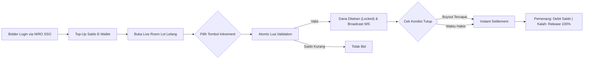
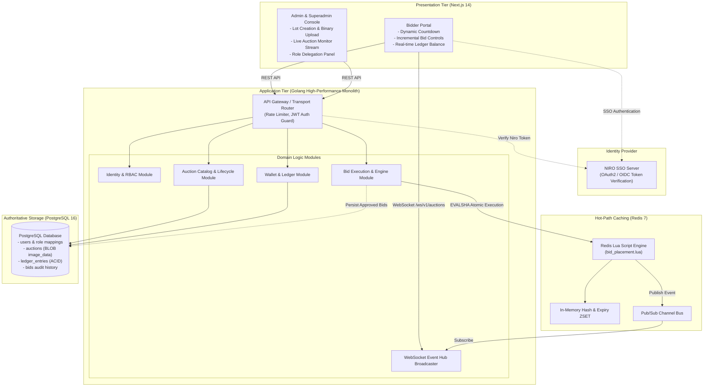
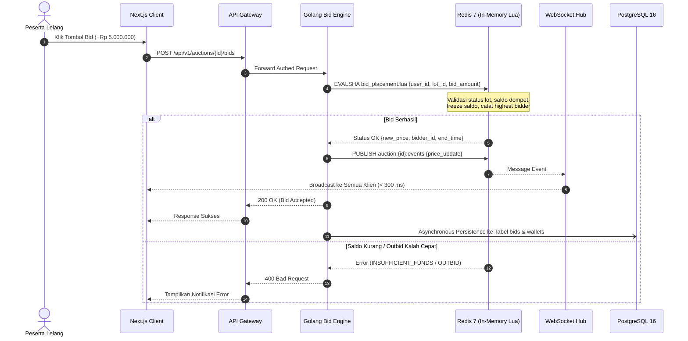

# HIGH LEVEL DESIGN DOCUMENT
## Real-Time Luxury Auction Engine
### Digital Auction & Bidding Platform

| Metadata | Value |
|---|---|
| **Prepared By :** | System Architecture & Delivery Team |
| **Date :** | 24 Oct 2026 |
| **Version :** | 1.0 |

---

## 1. Governance

### 1.1 Contributors
| Name | Position |
|---|---|
| Daniel H. S. | System Analyst / Solution Architect |
| Alini | Technical Lead |
| Geri Setyo Andrian | Project Manager |

### 1.2 Approvals
| Name | Position | Date | Signature |
|---|---|:---:|:---:|
| Geri Setyo Andrian | Project Manager Delivery Team | 24 Oct 2026 | `[ APPROVED & SIGNED ]` |
| Alini | Technical Architect / Tech Lead Delivery Team | 24 Oct 2026 | `[ APPROVED & SIGNED ]` |
| Daniel H. S. | System Analyst Delivery Team | 24 Oct 2026 | `[ APPROVED & SIGNED ]` |

### 1.3 Revision History
| Version | Date | Author | Summary of Changes |
|---|---|---|---|
| 0.1 | 24 Oct 2026 | Daniel H. S. | Initial Document Draft (Analysis & Discovery) |
| 0.5 | 24 Oct 2026 | Daniel H. S. | Added Dual-Model Auction, Velocity Anti-sniping, Redis Lua |
| 1.0 | 24 Oct 2026 | Daniel H. S. | Baseline Alignment with Enterprise Template Structure & Sign-Off |

---

## 2. Table of Contents
- [1. Governance](#1-governance)
  - [1.1 Contributors](#11-contributors)
  - [1.2 Approvals](#12-approvals)
  - [1.3 Revision History](#13-revision-history)
- [2. Table of Contents](#2-table-of-contents)
- [3. Introduction](#3-introduction)
  - [3.1 High-Level Design Overview](#31-high-level-design-overview)
  - [3.2 Glossaries](#32-glossaries)
  - [3.3 Objective Overview](#33-objective-overview)
  - [3.4 References](#34-references)
- [4. Executive Summary](#4-executive-summary)
  - [4.1 Purpose and Objectives](#41-purpose-and-objectives)
  - [4.2 As-is vs To-be Architecture](#42-as-is-vs-to-be-architecture)
- [5. Business Architecture](#5-business-architecture)
  - [5.1 Actors & Roles](#51-actors--roles)
  - [5.2 Business Capabilities](#52-business-capabilities)
  - [5.3 Business Process Flow](#53-business-process-flow)
- [6. Application & Integration Architecture](#6-application--integration-architecture)
  - [6.1 Integration Landscape](#61-integration-landscape)
  - [6.2 Impacted Objects / Components](#62-impacted-objects--components)
  - [6.3 High-Level Sequence Diagrams](#63-high-level-sequence-diagrams)
- [7. Technology & Data Architecture](#7-technology--data-architecture)
  - [7.1 In-Memory Hot-Path Tier (Redis 7)](#71-in-memory-hot-path-tier-redis-7)
  - [7.2 Persistent Database (PostgreSQL 16)](#72-persistent-database-postgresql-16)
  - [7.3 Golang Clean Architecture Layers](#73-golang-clean-architecture-layers)
- [8. Application Interfaces](#8-application-interfaces)
- [9. Architectural Decision Records (ADR Highlights)](#9-architectural-decision-records-adr-highlights)
- [10. Document Sign-Off Section](#10-document-sign-off-section)

---

## 3. Introduction

### 3.1 High-Level Design Overview
Dokumen High-Level Design (HLD) ini menyajikan cetak biru arsitektur menyeluruh dari **Real-Time Luxury Auction Engine**. Platform ini mengkombinasikan pertukaran pesan real-time sub-300 ms, penahanan agunan finansial dinamis, pencegahan sniping berbasis lonjakan velositas penawaran, dan integritas ACID multi-tier.

### 3.2 Glossaries
| No | Terms | Expansion | Definition |
|---|---|---|---|
| 1 | **SSO** | Single Sign-On | Mekanisme otentikasi terpusat pihak ketiga melalui penyedia identitas NIRO. |
| 2 | **SLA** | Service Level Agreement | Standar performa latensi sistem (sinkronisasi data penawaran < 300 ms). |
| 3 | **BLOB** | Binary Large Object | Format penyimpanan data biner mentah gambar lot lelang pada kolom `BYTEA` PostgreSQL. |
| 4 | **ACID** | Atomicity, Consistency, Isolation, Durability | Kepatuhan transaksi database relasional pada mutasi saldo dan status aset. |
| 5 | **WSS** | WebSocket Secure | Protokol komunikasi dua arah dupleks penuh terenkripsi TLS untuk streaming data lelang. |
| 6 | **AM** | Auction Manager | Pengelola kurasi lot, pembuatan katalog barang mewah, dan monitoring event lelang. |

### 3.3 Objective Overview
Tujuan inisiatif ini adalah merancang dan membangun mesin lelang online berperforma tinggi yang mampu memproses beban lonjakan penawaran hingga 10.000 transaksi/detik tanpa terjadi race condition, menjamin kepastian dana agunan peserta lelang, dan memberikan transparansi real-time kepada seluruh penawar.

### 3.4 References
- **Product Requirement & Hackathon Brief 2026:** [PDF Brief](file:///C:/Users/Daniel/.gemini/antigravity/brain/bd980ca4-23ee-44a3-a5ed-230fd0690b42/.user_uploaded/media_1792812187986_0083b4e8.pdf)
- **User Stories & Acceptance Criteria:** [`user-stories-and-ac.md`](file:///d:/Projects/Salt-Hackaton-2026/02_Projects/real-time-auction-engine/03_Requirements/user-stories-and-ac.md)
- **API Contracts Specification:** [`api-contracts.md`](file:///d:/Projects/Salt-Hackaton-2026/02_Projects/real-time-auction-engine/05_Integration/api-contracts.md)
- **Database Schema & Redis Lua Design:** [`database-schema.md`](file:///d:/Projects/Salt-Hackaton-2026/02_Projects/real-time-auction-engine/06_Data_Design/database-schema.md)

---

## 4. Executive Summary

### 4.1 Purpose and Objectives
Sebagai platform lelang barang mewah modern, keandalan sistem bergantung pada pencegahan penipuan (*fraud*), likuiditas saldo riil saat menawar, serta keadilan waktu lelang. Inisiatif ini menghadirkan:
1. **Pencegahan Bot & Kecurangan:** Eliminasi input teks bebas melalui tombol inkremental diskrit yang telah ditentukan kurator.
2. **Dynamic Collateral Protection:** Dana peserta ditahan (*locked*) secara proporsional saat melakukan penawaran, dan dicairkan kembali secara otomatis 100% saat lelang berakhir (bagi yang kalah) atau didebit penuh (bagi pemenang).
3. **Pemberian Waktu Adil (Anti-Sniping Velocity):** Otomatis memperpanjang durasi lot bila terjadi lonjakan penawaran $\ge 10\text{ bid/s}$ dalam 2 menit terakhir penutupan lelang.

### 4.2 As-is vs To-be Architecture

| Karakteristik | Kondisi Umum (As-Is / Legacy) | Solusi Platform (To-Be Architecture) |
|---|---|---|
| **Mekanisme Penawaran** | HTTP Polling berulang / refresh manual halaman | Dupleks Penuh WebSocket (< 300 ms latency broadcast) |
| **Kunci Persaingan Saldo** | Table-lock / Row-lock PostgreSQL lambat | In-Memory Mutex Atomic via Redis Lua Scripting (< 5 ms) |
| **Validasi Agunan** | Saldo mengendap pasif kaku di awal pendaftaran | Penahanan dinamis per penawaran lelang yang aktif |
| **Penyimpanan Media** | Bergantung pada object storage cloud eksternal | Terkapsulasi aman di Postgres BLOB (`BYTEA`), disajikan dalam Base64 terkompresi |
| **Autentikasi** | Registrasi akun terisolasi manual | Single Sign-On (NIRO SSO) terpadu dengan auto-provisioning |

---

## 5. Business Architecture

### 5.1 Actors & Roles
1. **Bidder (Peserta Lelang):** Pengguna terverifikasi NIRO SSO yang dapat melakukan top-up e-wallet, menelusuri katalog, melakukan penawaran inkremental tombol, dan mengaktifkan bot proxy.
2. **Auction Manager (Kurator / Admin Lelang):** Pengguna terverifikasi NIRO SSO yang dipromosikan untuk membuat listing lot lelang, mengunggah foto produk, menentukan harga dasar, kelipatan tombol bid, dan durasi anti-sniping.
3. **Superadmin:** Administrator utama platform yang mengelola hak akses promosi role, memantau audit trail, dan masuk melalui portal terisolasi email-password dengan pengamanan *progressive lockout*.

### 5.2 Business Capabilities
- **Katalog & Kurasi Lot Mewah:** Mendukung 5 kategori aset bergengsi (Luxury Watches, Designer Bags, Fine Jewelry, Collectible Vehicles, Rare Memorabilia).
- **Dual-Model Bidding:** Model Lelang Capped Buyout (pembelian instan saat menyentuh batas valuasi) dan Model Lelang Time-Window (penawar tertinggi di akhir periode).
- **Manajemen Dompet Agunan:** Ledger mutasi saldo riil tanpa biaya tersembunyi dengan batasan minimum top-up Rp 100.000.

### 5.3 Business Process Flow

---

## 6. Application & Integration Architecture

### 6.1 Integration Landscape

### 6.2 Impacted Objects / Components
| No | Impact | Object Name | Functions |
|---|---|---|---|
| 1 | **New** | `Auth Service` | Menangani pertukaran token NIRO SSO, auto-registrasi bidder, dan autentikasi email Superadmin. |
| 2 | **New** | `Bid Engine (Lua)` | Eksekusi transaksi penawaran atomik < 5 ms pada Redis memory tier. |
| 3 | **New** | `Auction Catalog` | Pengelolaan data lot, upload gambar format biner multipart ke PostgreSQL BLOB, dan konversi output Base64 terkompresi. |
| 4 | **New** | `Settlement Daemon`| Background service yang memantau expiry lot melalui Redis ZSET dan mengeksekusi settlement ACID. |
| 5 | **New** | `WebSocket Hub` | Penyiaran mutasi harga dan timer ke ribuan klien secara real-time. |

### 6.3 High-Level Sequence Diagrams
Alur penawaran atomik berkecepatan tinggi dapat dilihat pada diagram berikut:

---

## 7. Technology & Data Architecture

### 7.1 In-Memory Hot-Path Tier (Redis 7)
- **Struktur Lot Lelang (`auction:{lot_id}` - HASH):** Menyimpan status lelang, harga tertinggi terkini, ID penawar tertinggi, waktu berakhir, batas valuasi beli langsung, dan toleransi velositas penawaran.
- **Struktur Saldo Agunan (`wallet:{user_id}` - HASH):** Mengelola `available_balance` dan `locked_balance`.
- **Indeks Waktu Lelang (`auctions:expiry_zset` - ZSET):** Score berupa Unix Timestamp dari `end_time` untuk mendeteksi penutupan lelang secara presisi per 1 detik.

### 7.2 Persistent Database (PostgreSQL 16)
- **Tabel Kunci:** `users`, `wallets`, `ledger_entries`, `auctions`, `bids`, `proxy_bids`, `asset_ownership`.
- **Integritas Gambar:** Kolom `image_data BYTEA` dan `image_mime_type VARCHAR` memastikan dokumen dan katalog lelang berdiri mandiri tanpa ketergantungan storage pihak ketiga.

### 7.3 Golang Clean Architecture Layers
Pemisahan kode mengikuti standar arsitektur bersih:
- `cmd/api`: Titik masuk aplikasi dan dependency injection.
- `internal/domain`: Entitas inti aturan lelang tanpa dependensi framework.
- `internal/usecase`: Orkestrasi alur bisnis lelang dan dompet.
- `internal/repository`: Implementasi driver PostgreSQL dan Redis Client.
- `internal/transport`: HTTP REST endpoints dan WebSocket Hub.

---

## 8. Application Interfaces
Daftar antarmuka inti sistem terdiri dari 14 endpoint utama:
1. `GET /api/v1/auth/niro/authorize-url` — Dapatkan URL redirect SSO.
2. `POST /api/v1/auth/login/niro` — Tukar token SSO NIRO & provisioning otomatis.
3. `POST /api/v1/auth/login/email` — Login kredensial internal Superadmin.
4. `PATCH /api/v1/admin/users/:id/role` — Promosi wewenang user ke Auction Manager.
5. `GET /api/v1/auctions/active` — List katalog lelang aktif (termasuk pagination meta).
6. `GET /api/v1/auctions/:id` — Detail spesifik lot lelang (data Base64 gambar).
7. `POST /api/v1/auctions/:id/bids` — Pengiriman penawaran tombol inkremental.
8. `POST /api/v1/auctions/:id/proxy-bid` — Aktivasi bot penawar otomatis.
9. `DELETE /api/v1/auctions/:id/proxy-bid` — Pembatalan bot penawar otomatis.
10. `GET /api/v1/wallet/me` — Cek saldo riil dan saldo agunan tertahan.
11. `POST /api/v1/wallet/topup` — Top-up saldo khusus Bidder (min Rp 100.000).
12. `GET /api/v1/wallet/transactions` — Riwayat mutasi ledger finansial berhalaman.
13. `POST /api/v1/admin/auctions` — Listing lot lelang baru (multipart upload gambar BLOB & extend config).
14. `WS /api/v1/ws/auctions` — Koneksi duplex real-time telemetri lelang.

---

## 9. Architectural Decision Records (ADR Highlights)

| Keputusan Arsitektur | Alternatif yang Dipertimbangkan | Solusi Terpilih & Rationale |
|---|---|---|
| **Penanganan Konkurensi Bidding** | PostgreSQL Row Lock (`SELECT FOR UPDATE`) | **Redis Lua Scripting.** Menjalankan validasi saldo, penguncian harga, dan anti-sniping dalam satu siklus memori (< 5 ms), menjamin SLA < 300 ms bebas *lock contention*. |
| **Mekanisme Agunan Finansial** | Saldo Mengendap Wajib Pasif | **Dynamic Hold on Bid.** Saldo peserta ditahan hanya saat menawar lelang aktif, dan dicairkan 100% saat lelang berakhir jika tidak menang. |
| **Metode Penawaran Peserta** | Input Bebas Form Angka | **Discrete Increment Buttons.** Menghilangkan risiko kesalahan ketik (*typo*) dan memastikan kenaikan harga teratur sesuai ketentuan kurator. |
| **Penyimpanan Gambar Produk** | AWS S3 / Cloud Bucket | **PostgreSQL BYTEA (BLOB).** Menjaga portabilitas sistem lelang secara mandiri dan menghasilkan output Base64 terkompresi langsung via API. |
| **Arsitektur Autentikasi** | Single Auth Provider | **Dual-Login (NIRO SSO + Internal Superadmin).** Mengintegrasikan SSO eksternal organisasi untuk peserta sekaligus mempertahankan kedaulatan kontrol administratif master platform. |

---

## 10. Document Sign-Off Section

Dokumen arsitektur tingkat tinggi (*High-Level Design*) ini telah ditinjau secara komprehensif, diselaraskan dengan kebutuhan kompetisi Hackathon 2026 dan template resmi perusahaan, serta disahkan sebagai acuan implementasi arsitektur platform.

| Peran & Tanggung Jawab | Nama Pejabat | Status Persetujuan | Tanggal |
|---|---|:---:|:---:|
| **Project Manager** | **Geri Setyo Andrian** | `[ APPROVED & SIGNED ]` | 2026-10-24 |
| **Tech Lead** | **Alini** | `[ APPROVED & SIGNED ]` | 2026-10-24 |
| **System Analyst** | **Daniel H. S.** | `[ APPROVED & SIGNED ]` | 2026-10-24 |
