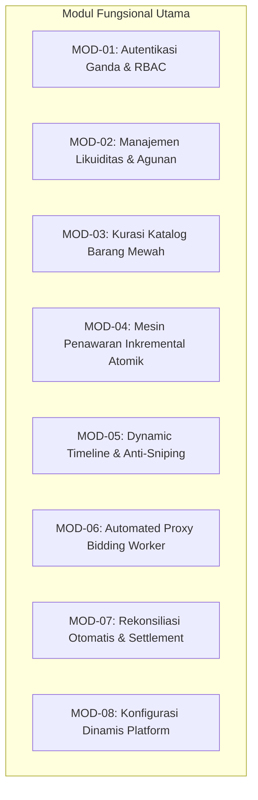

# Initial Functional Analysis (IFA) — Real-Time Luxury Auction Engine

| Metadata | Nilai |
|---|---|
| **Dokumen** | Initial Functional Analysis (IFA) |
| **Proyek** | Real-Time Auction & Bidding Engine (Fintech / E-Commerce) |
| **Versi** | v1.0.0 |
| **Status** | `Approved Baseline` |
| **Tanggal** | 2026-10-24 |
| **Penulis** | Senior System Analyst & Solution Architect |

---

## 1. Ringkasan Eksekutif & Latar Belakang Bisnis

Platform ini merupakan mesin lelang berkecepatan tinggi (*high-frequency auction engine*) khusus untuk **Barang Pribadi Bermerek Bernilai Tinggi (*Luxury Brand Goods & High-Value Collectibles*)** seperti Rolex, Hermès, Patek Philippe, Cartier, dan mobil kolektor (Vintage Porsche).

Tantangan utama yang diselesaikan:
1. **Penawaran Tanpa Jaminan Dana (*Unbacked Bids*):** Diatasi dengan arsitektur agunan (*collateral hold* dinamis).
2. **Kecurangan Detik Terakhir (*Bid Sniping*):** Diatasi dengan mesin adaptasi waktu dinamis (*anti-sniping engine*).
3. **Kekakuan Model Lelang:** Diatasi dengan model ganda: *Capped Value* (langsung laku saat mencapai harga maksimal) dan *Uncapped* (kompetisi terbuka dalam jendela waktu yang ditentukan Auction Manager, misal 1 hari).
4. **Masalah Human Error Penawaran:** Diatasi dengan sistem tombol inkremental resmi (tanpa input teks manual bebas).

---

## 2. Dekomposisi Modul Fungsional

---

## 3. Rincian Analisis Fungsional per Modul

### MOD-01: Autentikasi Ganda, RBAC, & Kebijakan Keamanan Login
* **Fungsi:** Memisahkan login peserta via **NIRO SSO** dan login khusus **Superadmin** dengan Email & Password internal, dilengkapi proteksi *progressive lock*.
* **Fitur yang Di-takeout (Dihapus dari Lingkup):**
  - **Forgot Password:** Dihapus / tidak diimplementasikan.
  - **Kickout Sesi Otomatis:** Dihapus / tidak diimplementasikan.
* **Aturan Login Berdasarkan Peran:**
  - **Peserta (Bidder & Auction Manager):** Wajib login menggunakan tombol **"Login with NIRO"**. Jika mencoba login dengan email/password biasa, sistem menolak dan mengarahkan ke NIRO.
  - **Superadmin:** Login menggunakan **Email dan Password** (minimal 12 karakter).
* **Kebijakan Penguncian Bertingkat (Progressive Lockout Policy untuk Superadmin):**
  Untuk mencegah serangan *brute force*, kegagalan login berturut-turut pada akun Superadmin dikenakan penalti waktu tunggu yang berlipat ganda (*exponential backoff lockout*):
  1. **Level 1 (Salah 3x pertama):** Akun terkunci sementara, wajib menunggu **1 menit** sebelum bisa mencoba kembali.
  2. **Level 2 (Salah 3x berikutnya / akumulasi 6x):** Penalti waktu tunggu berlipat ganda menjadi **2 menit**.
  3. **Level 3 (Salah 3x berikutnya / akumulasi 9x):** Penalti waktu tunggu meningkat tajam menjadi **1 jam (60 menit)**.
* **Manajemen Peran:** Superadmin berhak menetapkan dan mempromosikan pengguna login NIRO menjadi **Auction Manager (Admin)**.

### MOD-02: Manajemen Likuiditas & Agunan (Collateral Hold on Bid)
* **Fungsi:** Mengelola saldo bebas dan saldo tertahan.
* **Aturan Bisnis:**
  - Tidak ada saldo minimum mengendap pasif. Pengguna bebas melakukan top-up kapan saja.
  - **Saldo Tertahan Saat Bidding:** Saat peserta menawar Rp 75.000 dengan saldo Rp 100.000, penawaran sah. Saldo Rp 75.000 langsung dipindahkan ke status *Locked (Tertahan)*, sisa bebas menjadi Rp 25.000.
  - **Tertahan Sepanjang Periode Lelang (No Instant Unfreeze on Outbid):** Saldo yang sudah terkunci saat bidding **TIDAK langsung dilepas saat tersalip lawan**. Saldo tersebut tetap berstatus tertahan (*Locked*) hingga **periode lelang pada lot tersebut benar-benar selesai** (baik karena waktu habis pada lelang Uncapped maupun Instant Buyout pada lelang Capped).
  - **Pelepasan Akhir (Finality Settlement):** Setelah lelang mencapai status selesai/final:
    - Dana penawar tertinggi (pemenang) dipotong permanen (*settled/deducted*) sebagai pembayaran aset.
    - Dana penawar yang kalah baru dilepaskan 100% kembali ke saldo bebas (*Available Balance*) pada tahap penyelesaian akhir ini.

### MOD-03: Kurasi Katalog Barang Bernilai Tinggi
* **Fungsi:** Pengelolaan listing lot barang bernilai tinggi oleh Auction Manager.
* **Aturan Bisnis:**
  - Wajib memiliki atribut: Judul Aset, Kategori aset (`LUXURY_WATCHES`, `DESIGNER_BAGS`, `FINE_JEWELRY`, `COLLECTIBLE_VEHICLES`, `RARE_MEMORABILIA`), Grade Kondisi, dan Bukti Jaminan Keaslian (*Certificate / Box & Papers*). (Tidak memerlukan pengisian field merek/brand terpisah).
  - Wajib menentukan **Open Bid (Harga Minimal)** dan **Jendela Waktu Lelang (*Time Window*, misal 1 hari)**.
  - **Harga Maksimal (Buyout Ceiling):** Bersifat opsional.

### MOD-04: Mesin Penawaran Inkremental Atomik (The Core Hot-Path)
* **Fungsi:** Eksekusi penawaran berkecepatan tinggi dengan latensi < 300 ms tanpa *race condition*.
* **Aturan Bisnis:**
  - Penawaran dilakukan dengan menekan tombol pilihan inkremental resmi (misal: `+Rp 10k`, `+Rp 50k`, `+Rp 100k`) atau tombol **Buyout Langsung**.
  - Validasi dan penguncian dilakukan secara serial di memori melalui Redis Lua Scripting sebelum dicatat ke PostgreSQL.

### MOD-05: Adaptasi Waktu Dinamis (Anti-Sniping Engine: Velocity-Based)
* **Fungsi:** Melindungi integritas pasar dari manipulasi tawaran di detik-detik penutupan lelang (*bid sniping*) menggunakan pemantauan kecepatan penawaran (*submission velocity*).
* **Aturan Bisnis:**
  - **Zona Pemicu (*Trigger Window*):** Aktif pada **2 menit terakhir** sebelum jadwal lelang berakhir (`sisa_waktu <= 120 detik`).
  - **Pengecekan Kepadatan Trafik (*Velocity Threshold*):** Sistem memantau frekuensi penawaran setiap detik. Jika terjadi lonjakan **$\ge$ 10 penawaran dalam 1 detik (*10 hits/second*)**, sistem menganggap terjadi perang tawar-menawar intensif dan langsung memicu perpanjangan waktu (*instant dynamic extension*).
  - **Besaran Waktu Perpanjangan (*Extension Duration*):** Ditentukan secara fleksibel oleh Auction Manager pada saat **membuat listing lot lelang** (`anti_sniping_extension_minutes`), bersifat opsional dengan pilihan berapa menit tambahan (misal: +1 menit, +2 menit, atau +5 menit). Jika lot tidak mengaktifkan perpanjangan waktu, maka waktu tidak bertambah.
  - **Sinkronisasi Instan:** Begitu terpicu, waktu akhir lelang yang baru langsung disiarkan ke seluruh pengamat melalui Server-Sent Events (SSE) event `TIME_EXTENDED`.

### MOD-06: Automated Proxy Bidding Worker
* **Fungsi:** Menjalankan penawaran otomatis atas nama peserta hingga batas limit pribadi.
* **Aturan Bisnis:**
  - Peserta menyetel `max_limit`. Saldo bebas peserta wajib $\ge$ `max_limit`.
  - Background worker otomatis menaikkan tawaran sebesar 1 kelipatan inkremental setiap kali tawaran peserta disalip oleh penawar lain.

### MOD-07: Rekonsiliasi Otomatis & Settlement
* **Fungsi:** Menuntaskan transaksi saat lelang mencapai finalitas.
* **Aturan Bisnis:**
  - Finalitas tercapai jika: (1) Waktu hitung mundur lelang habis (model Uncapped), atau (2) Ada penawar yang menawar harga maksimal (model Capped Buyout).
  - Pemenang: Saldo tertahan dipotong permanen (*deducted*) dan hak kepemilikan aset diterbitkan di tabel `asset_ownership`.
  - Peserta Kalah: Dipastikan 100% saldo jaminan yang pernah tertahan telah bebas kembali tanpa sisa.

## 4. Matriks Hak Akses Menu & Peran (Role-Based Access Control / RBAC)

Berikut adalah pembagian hak akses menu antarmuka yang berlaku di sistem:

| Fitur / Menu di Aplikasi | Bidder (Peserta) | Auction Manager (AM) | Super Admin | Catatan Aturan Bisnis |
|---|:---:|:---:|:---:|---|
| **Metode Login Resmi** | **Login with NIRO** | **Login with NIRO** | **Email & Password** | Bidder & AM via NIRO; Superadmin via Email & Password internal. |
| **Menu E-Wallet & Top-Up (Min. Rp 100k)** | ✅ | ❌ | ❌ | **Hanya Bidder** yang memiliki dompet & hak top-up saldo jaminan. |
| **Menu Katalog & Detail Barang** | ✅ | ✅ | ✅ | Dapat dilihat oleh seluruh peran (*universal visibility*). |
| **Menu Pasang Aturan Bid (Open Bid & Inkremental)** | ❌ | ✅ | ✅ | **Hanya AM & Superadmin** yang mengatur kelipatan dan batas lelang saat membuat listing. |
| **Aksi Bidding (Tombol Tawaran & Proxy)** | ✅ | ❌ | ❌ | **Hanya Bidder** yang berhak memasang penawaran aktif & pasang bot proxy. |
| **Menu Buat Listing Lot Lelang Baru** | ❌ | ✅ | ✅ | Dibuat oleh Auction Manager (atau Superadmin). |
| **Menu Live Bid Monitoring Stream** | ✅ | ✅ | ✅ | **Bisa diakses ketiganya:** Peserta memantau lelang live, AM memantau operasional, Superadmin mengawasi integritas. |
| **Menu Pengawasan Rekonsiliasi & Settlement** | ❌ | ✅ | ✅ | Pengawasan audit finansial & penyelesaian hak aset. |
| **Menu Assign Role Pengguna (Promote AM)** | ❌ | ❌ | ✅ | **Eksklusif Superadmin** untuk menetapkan pengguna NIRO menjadi AM. |
| **Menu Konfigurasi Parameter Waktu Sistem** | ❌ | ❌ | ✅ | **Eksklusif Superadmin** untuk ubah trigger/extension secara global. |
