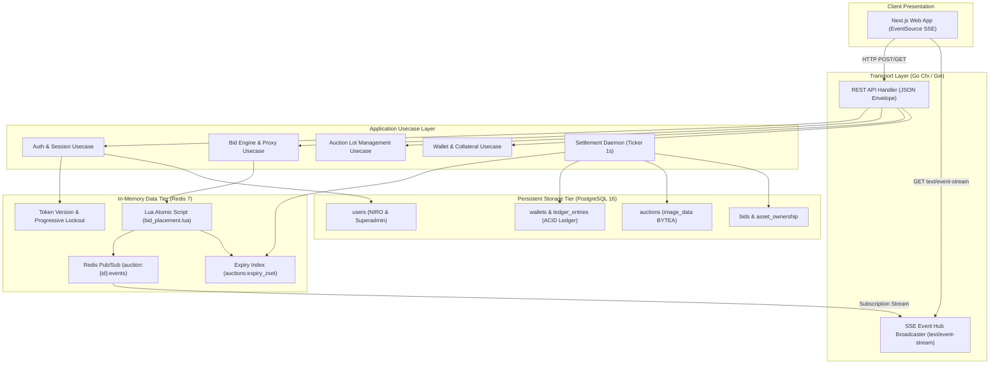
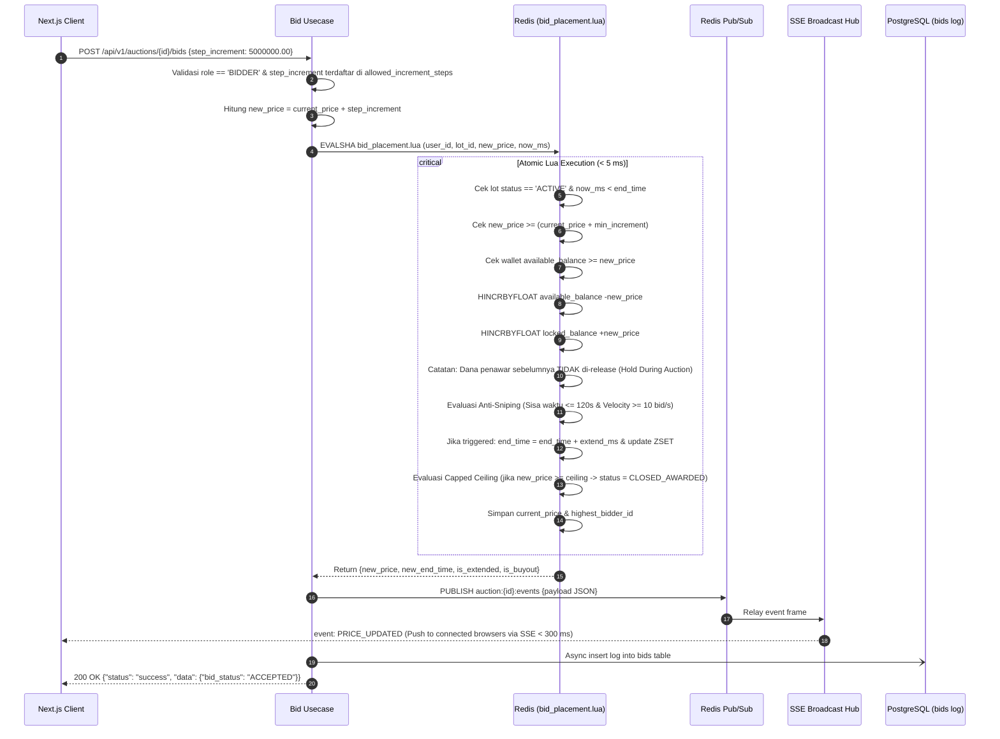
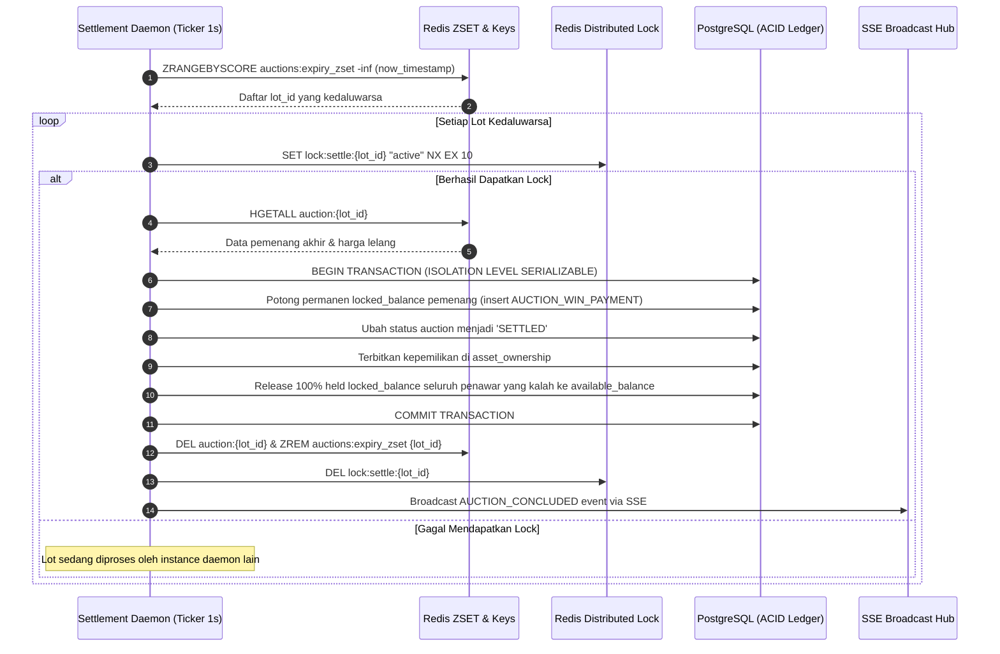
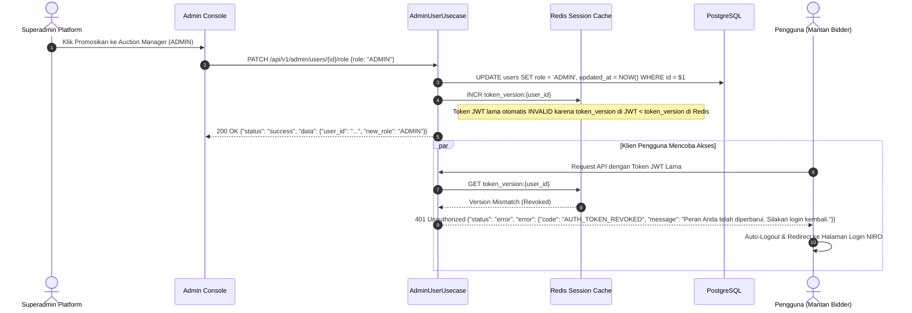
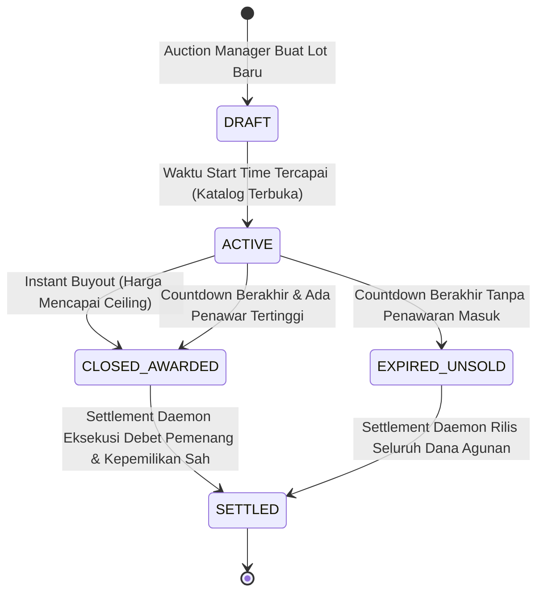

# LOW LEVEL DESIGN DOCUMENT
## Real-Time Luxury Auction Engine
### Core Engine, Bidding Lua, Server-Sent Events (SSE) & API Implementation

| Metadata | Value |
|---|---|
| **Prepared By :** | System Architecture & Delivery Team |
| **Date :** | 24 Oct 2026 |
| **Version :** | 2.0 |
| **Classification :** | Strictly Confidential / Technical Specification |

---

## 1. Governance

### 1.1 Contributors
| Name | Position |
|---|---|
| Daniel H. S. | System Analyst / Solution Architect |
| Alini | Technical Lead |
| Geri Setyo Andrian | Project Manager |

### 1.2 Approvals
| Name | Position | Date | Signature |
|---|---|:---:|:---:|
| Geri Setyo Andrian | Project Manager Delivery Team | 24 Oct 2026 | `[ APPROVED & SIGNED ]` |
| Alini | Technical Architect / Tech Lead Delivery Team | 24 Oct 2026 | `[ APPROVED & SIGNED ]` |
| Daniel H. S. | System Analyst Delivery Team | 24 Oct 2026 | `[ APPROVED & SIGNED ]` |

### 1.3 Revision History
| Version | Date | Author | Summary of Changes |
|---|---|---|---|
| 0.1 | 24 Oct 2026 | Daniel H. S. | Initial Technical Draft (Components & Goroutines) |
| 0.5 | 24 Oct 2026 | Daniel H. S. | Added Lua Scripting Logic, Settlement Daemon, and 14 API Endpoints |
| 1.0 | 24 Oct 2026 | Daniel H. S. | Baseline Alignment with Enterprise Template Structure & Sign-Off |
| 2.0 | 24 Oct 2026 | Daniel H. S. | **Deep Technical Refinement:** Spesifikasi Server-Sent Events (SSE HTTP/2), full code Lua atomik, struktur Go struct murni, kontrak teknis 14 API dengan standar envelope BE (`success`/`error`), dan manajemen auto-logout JWT versi Redis. |

---

## 2. Table of Contents
- [1. Governance](#1-governance)
  - [1.1 Contributors](#11-contributors)
  - [1.2 Approvals](#12-approvals)
  - [1.3 Revision History](#13-revision-history)
- [2. Table of Contents](#2-table-of-contents)
- [3. Introduction & Technical Architecture Stack](#3-introduction--technical-architecture-stack)
  - [3.1 Low-Level Design Overview](#31-low-level-design-overview)
  - [3.2 Technology Stack Details](#32-technology-stack-details)
  - [3.3 Glossaries](#33-glossaries)
  - [3.4 Standard Response Envelope & Monetary Format](#34-standard-response-envelope--monetary-format)
  - [3.5 References](#35-references)
- [4. System & Integration Landscape](#4-system--integration-landscape)
  - [4.1 Component Interaction Diagram](#41-component-interaction-diagram)
  - [4.2 Impacted Objects & Detailed Functionality](#42-impacted-objects--detailed-functionality)
  - [4.3 Go Domain Models (Pure Structs)](#43-go-domain-models-pure-structs)
- [5. Detailed Sequence Diagrams & Algorithms](#5-detailed-sequence-diagrams--algorithms)
  - [5.1 Incremental Bid Execution (bid_placement.lua)](#51-incremental-bid-execution-bid_placementlua)
  - [5.2 Settlement Daemon Expiry Flow](#52-settlement-daemon-expiry-flow)
  - [5.3 Role Promotion & Mandatory Auto-Logout Sequence](#53-role-promotion--mandatory-auto-logout-sequence)
- [6. Application Interfaces & API Contracts](#6-application-interfaces--api-contracts)
  - [6.1 Complete Endpoint Specifications](#61-complete-endpoint-specifications)
  - [6.2 Server-Sent Events (SSE) Protocol & Broadcast Hub](#62-server-sent-events-sse-protocol--broadcast-hub)
- [7. In-Memory, Caching & Data Structures](#7-in-memory-caching--data-structures)
  - [7.1 Complete Lua Script: bid_placement.lua](#71-complete-lua-script-bid_placementlua)
  - [7.2 Redis Key Schema & TTL Management](#72-redis-key-schema--ttl-management)
- [8. State Machine & Lifecycle Specifications](#8-state-machine--lifecycle-specifications)
- [9. Document Sign-Off Section](#9-document-sign-off-section)

---

## 3. Introduction & Technical Architecture Stack

### 3.1 Low-Level Design Overview
Dokumen Low-Level Design (LLD) ini menguraikan spesifikasi implementasi perangkat lunak pada tingkat kode, modul Go, skrip in-memory Redis Lua, antarmuka REST API, streaming **Server-Sent Events (SSE)**, serta state machine database relasional untuk **Real-Time Luxury Auction Engine**.

### 3.2 Technology Stack Details
Platform dibangun menggunakan arsitektur enterprise modern dengan standar performa dan konkurensi tinggi:
* **Backend Runtime:** Go (Golang) v1.22+ menggunakan router berperforma tinggi (`Chi` / `Gin`) dengan concurrency berbasis Goroutine dan Channels.
* **In-Memory Cache & Mutex:** Redis v7.2 Cluster (Replication Mode) dengan *Lua Engine* untuk eksekusi atomik hot-path penawaran lelang (< 5 ms execution time) dan Pub/Sub message broker.
* **Authoritative Database:** PostgreSQL v16 dengan konfigurasi ACID transaction level `SERIALIZABLE` untuk mutasi saldo e-wallet dan double-entry ledger.
* **Real-Time Streaming:** **Server-Sent Events (SSE)** berjalan di atas **HTTP/2** persisten (`text/event-stream`), ramah terhadap enterprise firewall, proxy WAF, dan hemat bandwidth dengan latensi siaran < 300 ms.
* **Identity & Authentication:** Dual-method Authentication: NIRO OAuth2 SSO untuk `BIDDER` & `ADMIN` (Auction Manager), serta Email & Password dengan PBKDF2/Argon2id dan Progressive Lockout untuk `SUPERADMIN`.
* **Image Storage Engine:** Kolom PostgreSQL `BYTEA` (Binary Large Object) yang disimpan langsung di database tanpa ketergantungan storage S3 pihak ketiga, di-serve ke frontend sebagai string terkompresi Base64.
* **Frontend Web Application:** Next.js v14+ (React 18, TypeScript, Tailwind CSS) dengan modul HTML5 `EventSource` untuk konsumsi stream SSE lelang.

### 3.3 Glossaries
| No | Terms | Expansion | Definition |
|---|---|---|---|
| 1 | **SSE** | Server-Sent Events | Protokol streaming data satu arah (Server-to-Client) berbasis HTTP/2 persisten (`text/event-stream`) dengan auto-reconnect bawaan peramban. |
| 2 | **EVALSHA** | Evaluate SHA1 Digest | Perintah Redis untuk mengeksekusi skrip Lua yang telah di-cache server secara atomic tanpa overhead transfer skrip berulang. |
| 3 | **BYTEA** | Byte Array | Tipe data kolom PostgreSQL untuk menyimpan representasi biner gambar produk secara langsung di database. |
| 4 | **ZSET** | Sorted Set | Struktur data Redis berurutan berdasarkan score waktu untuk tracking expiry lelang secara real-time. |
| 5 | **float64** | 64-bit IEEE 754 Floating-Point | Tipe data standar pada Go/JSON untuk merepresentasikan seluruh nilai moneter rupiah dan saldo akun secara presisi. |
| 6 | **Token Revocation** | Pembatalan Sesi Instan | Mekanisme pembatalan JWT seketika menggunakan versioning key di Redis (`token_version:{user_id}`) saat role user dinaikkan. |

### 3.4 Standard Response Envelope & Monetary Format
Sesuai standar Backend Coding Guidelines:
1. **Respon Sukses (HTTP 200 / 201):**
   ```json
   {
     "status": "success",
     "data": {}
   }
   ```
2. **Respon Gagal (HTTP 4xx / 5xx):**
   ```json
   {
     "status": "error",
     "error": {
       "code": "ERROR_CODE_STRING",
       "message": "Pesan deskriptif dalam Bahasa Indonesia"
     }
   }
   ```
3. **Format Moneter:** Seluruh field moneter (`available_balance`, `locked_balance`, `current_price`, `bid_amount`, `min_price`, `max_price`) wajib menggunakan representasi numerik desimal `float64` tanpa pembulatan integer parsial.

### 3.5 References
- **High-Level Design Document:** [`high-level-design.md`](file:///d:/Projects/Salt-Hackaton-2026/02_Projects/real-time-auction-engine/04_Design/high-level-design.md)
- **Database Schema & Redis Lua Design:** [`database-schema.md`](file:///d:/Projects/Salt-Hackaton-2026/02_Projects/real-time-auction-engine/06_Data_Design/database-schema.md)
- **API Contracts Specification:** [`api-contracts.md`](file:///d:/Projects/Salt-Hackaton-2026/02_Projects/real-time-auction-engine/05_Integration/api-contracts.md)

---

## 4. System & Integration Landscape

### 4.1 Component Interaction Diagram
Arsitektur internal modul Go dan transport Server-Sent Events (SSE):



### 4.2 Impacted Objects & Detailed Functionality
| No | Impact | Object Name | Functions & Technical Details |
|---|---|---|---|
| 1 | **New** | `internal/domain` | Definisi Go struct murni: `User`, `Wallet`, `Auction`, `Bid`, `LedgerEntry` dengan strict tipe moneter `float64`. |
| 2 | **New** | `internal/usecase/bid` | Validasi kelipatan tombol bertingkat diskrit, kalkulasi instant buy-out ceiling, dan orkestrasi skrip Redis Lua atomik. |
| 3 | **New** | `internal/usecase/auth` | Login NIRO SSO, progressive lockout Superadmin (1m $\rightarrow$ 2m $\rightarrow$ 1h), serta **Token Revocation (Auto-Logout)** via versioning key Redis. |
| 4 | **New** | `internal/repository/redis`| Eksekusi EVALSHA `bid_placement.lua`, pool koneksi Redigo/go-redis, Sorted Set expiry (`ZRANGEBYSCORE`), dan pub/sub channel. |
| 5 | **New** | `internal/transport/sse` | Multiplexing koneksi client persistent HTTP `text/event-stream`, event dispatcher fan-out, dan heartbeat pulse ping setiap 15 detik. |
| 6 | **New** | `internal/daemon/settlement`| Daemon berjadwal per 1 detik yang membaca lelang kedaluwarsa, mengunci lelang via distributed lock, dan menyelesaikan mutasi ACID. |

### 4.3 Go Domain Models (Pure Structs)

```go
package domain

import (
	"time"
	"github.com/google/uuid"
)

type Role string

const (
	RoleBidder     Role = "BIDDER"
	RoleAdmin      Role = "ADMIN"      // Auction Manager
	RoleSuperAdmin Role = "SUPERADMIN"
)

type User struct {
	ID           uuid.UUID `json:"id"`
	NiroUserID   *string   `json:"niro_user_id,omitempty"`
	Username     string    `json:"username"`
	Email        string    `json:"email"`
	PasswordHash *string   `json:"-"`
	AuthProvider string    `json:"auth_provider"` // "NIRO" | "LOCAL"
	Role         Role      `json:"role"`
	TokenVersion int64     `json:"token_version"`
	CreatedAt    time.Time `json:"created_at"`
	UpdatedAt    time.Time `json:"updated_at"`
}

type Wallet struct {
	ID               uuid.UUID `json:"id"`
	UserID           uuid.UUID `json:"user_id"`
	AvailableBalance float64   `json:"available_balance"` // float64 mandatory
	LockedBalance    float64   `json:"locked_balance"`    // float64 mandatory
	Version          int64     `json:"version"`
	UpdatedAt        time.Time `json:"updated_at"`
}

type AuctionModel string
type AuctionStatus string
type AssetCategory string

const (
	ModelUncapped AuctionModel = "UNCAPPED"
	ModelCapped   AuctionModel = "CAPPED"

	StatusDraft         AuctionStatus = "DRAFT"
	StatusActive        AuctionStatus = "ACTIVE"
	StatusClosedAwarded AuctionStatus = "CLOSED_AWARDED"
	StatusSettled       AuctionStatus = "SETTLED"
	StatusExpiredUnsold AuctionStatus = "EXPIRED_UNSOLD"

	CatWatches     AssetCategory = "LUXURY_WATCHES"
	CatBags        AssetCategory = "DESIGNER_BAGS"
	CatJewelry     AssetCategory = "FINE_JEWELRY"
	CatVehicles    AssetCategory = "COLLECTIBLE_VEHICLES"
	CatMemorabilia AssetCategory = "RARE_MEMORABILIA"
)

type Auction struct {
	ID                          uuid.UUID     `json:"id"`
	Title                       string        `json:"title"`
	Category                    AssetCategory `json:"category"`
	ConditionGrade              string        `json:"condition_grade"`
	AuthenticityGuarantee       string        `json:"authenticity_guarantee"`
	Description                 string        `json:"description"`
	ImageData                   []byte        `json:"-"`                     // Stored as BYTEA in DB
	ImageMimeType               string        `json:"image_mime_type"`
	MinPrice                    float64       `json:"min_price"`             // float64
	AllowedIncrementSteps       []float64     `json:"allowed_increment_steps"` // float64 array
	MaxPrice                    *float64      `json:"max_price,omitempty"`   // Buyout Ceiling
	CurrentPrice                float64       `json:"current_price"`         // float64
	StartTime                   time.Time     `json:"start_time"`
	EndTime                     time.Time     `json:"end_time"`
	AntiSnipingExtensionMinutes int           `json:"anti_sniping_extension_minutes"`
	HighestBidderID             *uuid.UUID    `json:"highest_bidder_id,omitempty"`
	ModelType                   AuctionModel  `json:"model_type"`
	Status                      AuctionStatus `json:"status"`
	CreatedBy                   uuid.UUID     `json:"created_by"`
	CreatedAt                   time.Time     `json:"created_at"`
	UpdatedAt                   time.Time     `json:"updated_at"`
}
```

---

## 5. Detailed Sequence Diagrams & Algorithms

### 5.1 Incremental Bid Execution (bid_placement.lua)



### 5.2 Settlement Daemon Expiry Flow



### 5.3 Role Promotion & Mandatory Auto-Logout Sequence

Ketika Superadmin mempromosikan user dari `BIDDER` menjadi `ADMIN` (Auction Manager), sesi lama user wajib dibatalkan seketika agar hak akses lama tidak disalahgunakan.



---

## 6. Application Interfaces & API Contracts

### 6.1 Complete Endpoint Specifications
Seluruh 14 endpoint implementasi transport API pada sistem dirancang dengan standar HTTP status, role authorization, dan response envelope baku:

| Method | Endpoint | Role | Deskripsi Teknis & Kontrak |
|---|---|---|---|
| `GET`  | `/api/v1/auth/niro/authorize-url` | Publik | Mendapatkan redirect URL resmi NIRO SSO beserta CSRF state token. |
| `POST` | `/api/v1/auth/login/niro` | Publik | Menerima `niro_token`. Jika baru, auto-register role `BIDDER`; jika terdaftar, buat sesi JWT dan load saldo dompet (`float64`). |
| `POST` | `/api/v1/auth/login/email` | Publik | Login email & password khusus `SUPERADMIN` (min. 12 karakter) dengan progressive lockout berbasis Redis TTL. |
| `GET`  | `/api/v1/admin/users` | `SUPERADMIN` | Mengambil daftar direktori pengguna NIRO (lengkap dengan pagination meta). |
| `PATCH`| `/api/v1/admin/users/:id/role` | `SUPERADMIN` | Mempromosikan role user menjadi `ADMIN` (Auction Manager) & memicu auto-logout via `token_version` Redis. |
| `GET`  | `/api/v1/wallet/me` | `BIDDER` | Mengambil saldo likuid (`available_balance`) dan tertahan (`locked_balance`) tipe `float64`. |
| `POST` | `/api/v1/wallet/topup` | `BIDDER` | Menambah saldo dompet khusus penawar (minimal deposit Rp 100.000,00, kelipatan rupiah utuh). |
| `GET`  | `/api/v1/auctions/active` | Publik | Daftar lot barang mewah aktif, pagination meta, dan thumbnail Base64 terkompresi. |
| `GET`  | `/api/v1/auctions/:id` | Publik | Detail lengkap lot, foto Base64 utuh, step increment tombol diskrit, jaminan keaslian, dan aturan lelang. |
| `POST` | `/api/v1/auctions/:id/bids` | `BIDDER` | Mengirim penawaran tombol bertingkat diskrit; mengeksekusi skrip Lua atomik, validasi buy-out & anti-sniping. |
| `POST` | `/api/v1/auctions/:id/proxy-bid` | `BIDDER` | Mengonfigurasi bot penawaran proxy otomatis dengan batas limit maksimal (`max_limit`). |
| `DELETE`| `/api/v1/auctions/:id/proxy-bid` | `BIDDER` | Membatalkan / mematikan bot penawaran proxy otomatis pada lot tertentu. |
| `POST` | `/api/v1/admin/auctions` | `ADMIN` | Membuat listing lot baru via `multipart/form-data`, file gambar biner langsung disimpan ke kolom PostgreSQL `BYTEA`. |
| `GET`  | `/api/v1/sse/auctions/:id` | Universal | **Server-Sent Events (SSE):** Streaming mutasi harga, countdown timer, dan event lelang per lot lelang. |
| `GET`  | `/api/v1/sse/catalog` | Universal | **Server-Sent Events (SSE):** Streaming ticker pembaruan katalog global di beranda / marketplace. |

---

### 6.2 Server-Sent Events (SSE) Protocol & Broadcast Hub

Sistem secara ketat menggunakan **Server-Sent Events (SSE)** berbasis HTTP/2 persisten untuk penyiaran data real-time:

* **Header HTTP Server:**
  ```http
  HTTP/1.1 200 OK
  Content-Type: text/event-stream
  Cache-Control: no-cache
  Connection: keep-alive
  X-Accel-Buffering: no
  Access-Control-Allow-Origin: *
  ```
* **Koneksi Room Lot:** `GET /api/v1/sse/auctions/:id`
* **Koneksi Global Catalog:** `GET /api/v1/sse/catalog`
* **Heartbeat Ping:** Setiap 15 detik, server mengirim komentar `: ping\n\n` untuk mencegah pemutusan koneksi oleh NAT/Load Balancer.
* **Auto-Reconnect:** Peramban Next.js menggunakan antarmuka native `EventSource`. Jika koneksi terputus, peramban otomatis menyambung ulang dengan menyertakan header `Last-Event-ID`.

#### Payload Event Streaming Resmi:

##### 1. Event `PRICE_UPDATED` (Penawaran Baru Sah)
```http
event: PRICE_UPDATED
id: 1729782400123
data: {"lot_id":"e0b9b3e1-872b-42e7-91a6-f7615cb38421","current_price":360000000.00,"highest_bidder_id":"3fa85f64-5717-4562-b3fc-2c963f66afa6","highest_bidder_masked":"Bu***or","end_time":"2026-10-25T14:00:00Z","is_extended":false,"total_bids":34}

```

##### 2. Event `TIME_EXTENDED` (Anti-Sniping Triggered)
```http
event: TIME_EXTENDED
id: 1729782415456
data: {"lot_id":"e0b9b3e1-872b-42e7-91a6-f7615cb38421","extension_minutes":2,"new_end_time":"2026-10-25T14:02:00Z","reason":"HIGH_VELOCITY_BIDDING"}

```

##### 3. Event `AUCTION_BUYOUT_CLOSED` (Instant Buyout Tercapai)
```http
event: AUCTION_BUYOUT_CLOSED
id: 1729782420789
data: {"lot_id":"e0b9b3e1-872b-42e7-91a6-f7615cb38421","winner_id":"3fa85f64-5717-4562-b3fc-2c963f66afa6","buyout_price":500000000.00,"status":"CLOSED_AWARDED"}

```

##### 4. Event `AUCTION_CONCLUDED` (Lelang Selesai & Settle Selesai)
```http
event: AUCTION_CONCLUDED
id: 1729782490000
data: {"lot_id":"e0b9b3e1-872b-42e7-91a6-f7615cb38421","final_price":360000000.00,"winner_id":"3fa85f64-5717-4562-b3fc-2c963f66afa6","status":"SETTLED"}

```

---

## 7. In-Memory, Caching & Data Structures

### 7.1 Complete Lua Script: bid_placement.lua
Skrip berikut dieksekusi secara atomik di dalam engine memori Redis melalui perintah `EVALSHA`:

```lua
-- KEYS: [1] auction_key, [2] bidder_wallet_key, [3] expiry_zset, [4] velocity_key
-- ARGV: [1] bidder_id, [2] bid_amount, [3] now_ms, [4] extension_minutes

local auction = redis.call('HMGET', KEYS[1], 'status', 'current_price', 'min_increment', 'end_time', 'model_type', 'valuation_ceiling')
local status = auction[1]
local current_price = tonumber(auction[2] or '0')
local min_increment = tonumber(auction[3] or '0')
local end_time = tonumber(auction[4] or '0')
local model_type = auction[5]
local valuation_ceiling = tonumber(auction[6] or '0')

local bidder_id = ARGV[1]
local bid_amount = tonumber(ARGV[2])
local now_ms = tonumber(ARGV[3])
local extension_minutes = tonumber(ARGV[4] or '2')

-- 1. Validasi Status Lelang dan Waktu Aktif
if status ~= 'ACTIVE' or now_ms >= end_time then
    return redis.error_reply("ERR_AUCTION_NOT_ACTIVE")
end

-- 2. Validasi Kenaikan Harga (Harus >= current_price + min_increment)
if bid_amount < (current_price + min_increment) then
    return redis.error_reply("ERR_BID_TOO_LOW")
end

-- 3. Validasi Saldo Likuid Penawar Baru
local available_bal = tonumber(redis.call('HGET', KEYS[2], 'available_balance') or '0')
if available_bal < bid_amount then
    return redis.error_reply("ERR_INSUFFICIENT_COLLATERAL")
end

-- 4. Kunci Agunan Penawar Baru Secara Atomik
redis.call('HINCRBYFLOAT', KEYS[2], 'available_balance', -bid_amount)
redis.call('HINCRBYFLOAT', KEYS[2], 'locked_balance', bid_amount)

-- CATATAN ATURAN BISNIS HACKATHON 2026:
-- Saldo penawar sebelumnya TIDAK dilepaskan (Hold During Bidding). 
-- Seluruh dana peserta tetap tertahan di locked_balance sampai lelang berakhir (Settled).

-- 5. Evaluasi Anti-Sniping (Critical Zone 2 Menit Terakhir = 120.000 ms)
local is_extended = 0
local new_end_time = end_time
local remaining_time_ms = end_time - now_ms

if remaining_time_ms <= 120000 then
    -- Hitung velositas bid dalam sliding window 1 detik via Redis sliding window counter
    local current_sec = math.floor(now_ms / 1000)
    local hits = redis.call('INCR', KEYS[4] .. ':' .. current_sec)
    redis.call('EXPIRE', KEYS[4] .. ':' .. current_sec, 5)

    if hits >= 10 then
        -- Lonjakan frekuensi penawaran >= 10 hit/detik -> Perpanjang waktu lelang
        local extension_ms = extension_minutes * 60 * 1000
        new_end_time = end_time + extension_ms
        is_extended = 1
        redis.call('HSET', KEYS[1], 'end_time', tostring(new_end_time))
        redis.call('ZADD', KEYS[3], new_end_time, KEYS[1]) -- Update expiry score di ZSET
    end
end

-- 6. Evaluasi Capped Valuation Ceiling (Buyout)
local is_buyout = 0
if model_type == 'CAPPED' and valuation_ceiling > 0 and bid_amount >= valuation_ceiling then
    is_buyout = 1
    redis.call('HSET', KEYS[1], 'status', 'CLOSED_AWARDED')
    redis.call('ZREM', KEYS[3], KEYS[1]) -- Hapus dari active expiry ZSET
end

-- 7. Perbarui Penawar Tertinggi dan Harga Terkini
redis.call('HMSET', KEYS[1], 'current_price', tostring(bid_amount), 'highest_bidder_id', bidder_id)

-- Return hasil eksekusi: {bid_amount, new_end_time, is_extended, is_buyout}
return {tostring(bid_amount), tostring(new_end_time), is_extended, is_buyout}
```

### 7.2 Redis Key Schema & TTL Management
| Key Name Pattern | Redis Type | TTL | Penjelasan & Struktur Data |
|---|---|:---:|---|
| `auction:{lot_id}` | `HASH` | No TTL (Persistent selama aktif) | Fields: `status`, `current_price`, `min_increment`, `end_time`, `highest_bidder_id`, `model_type`, `valuation_ceiling`. |
| `wallet:{user_id}` | `HASH` | No TTL | Fields: `available_balance`, `locked_balance` (selalu dihitung via `HINCRBYFLOAT`). |
| `auctions:expiry_zset` | `ZSET` | Persistent Index | Score: `end_time` (epoch milliseconds), Member: `{lot_id}`. Digunakan oleh Settlement Daemon. |
| `auction:velocity:{lot_id}:{sec}` | `STRING` | 5 detik | Counter sliding window integer penawaran per detik untuk evaluasi anti-sniping. |
| `token_version:{user_id}` | `STRING` | 30 hari | Integer version counter. Di-increment saat role diubah menjadi `ADMIN` untuk memicu auto-logout. |
| `lockout:superadmin:{email}` | `STRING` | 60s / 120s / 3600s | Progressive counter percobaan login gagal Superadmin sebelum akun dibekukan sementara. |
| `lock:settle:{lot_id}` | `STRING` | 10 detik | Distributed Mutex lock (`SET NX EX 10`) untuk menjamin settlement lelang dieksekusi tepat satu kali. |

---

## 8. State Machine & Lifecycle Specifications



---

## 9. Document Sign-Off Section

Dokumen perancangan tingkat rendah (*Low-Level Design*) v2.0 ini telah ditinjau secara mendalam dari segi kelayakan teknis, struktur data, algoritma usecase, antarmuka streaming Server-Sent Events (SSE), dan kesiapan pengujian TDD, serta secara resmi disahkan untuk tahap koding.

| Peran & Tanggung Jawab | Nama Pejabat | Status Persetujuan | Tanggal |
|---|---|:---:|:---:|
| **Project Manager** | **Geri Setyo Andrian** | `[ APPROVED & SIGNED ]` | 2026-10-24 |
| **Tech Lead** | **Alini** | `[ APPROVED & SIGNED ]` | 2026-10-24 |
| **System Analyst** | **Daniel H. S.** | `[ APPROVED & SIGNED ]` | 2026-10-24 |
