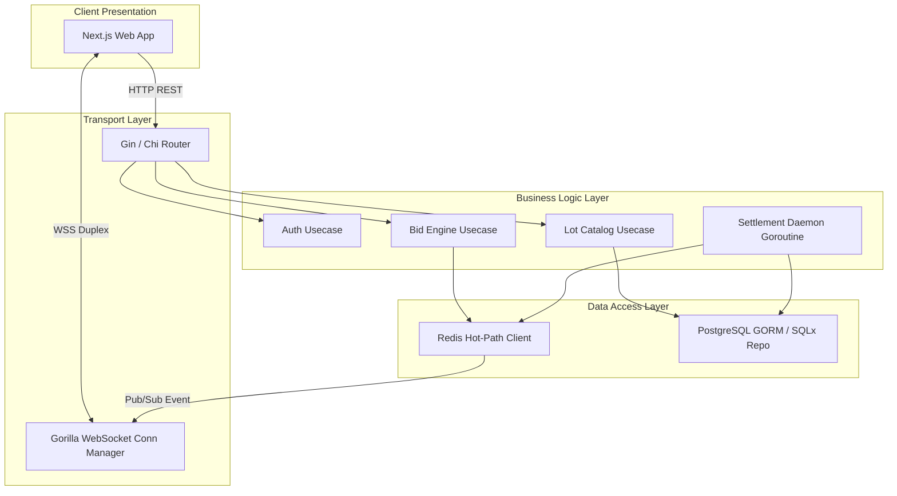
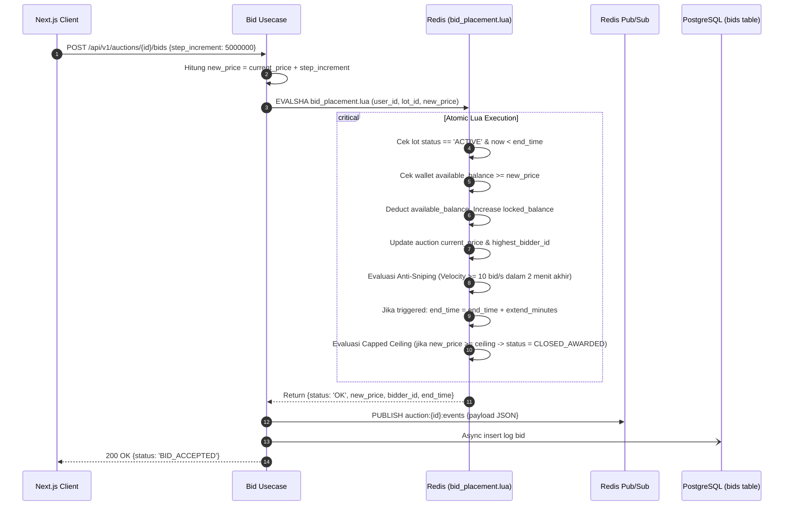
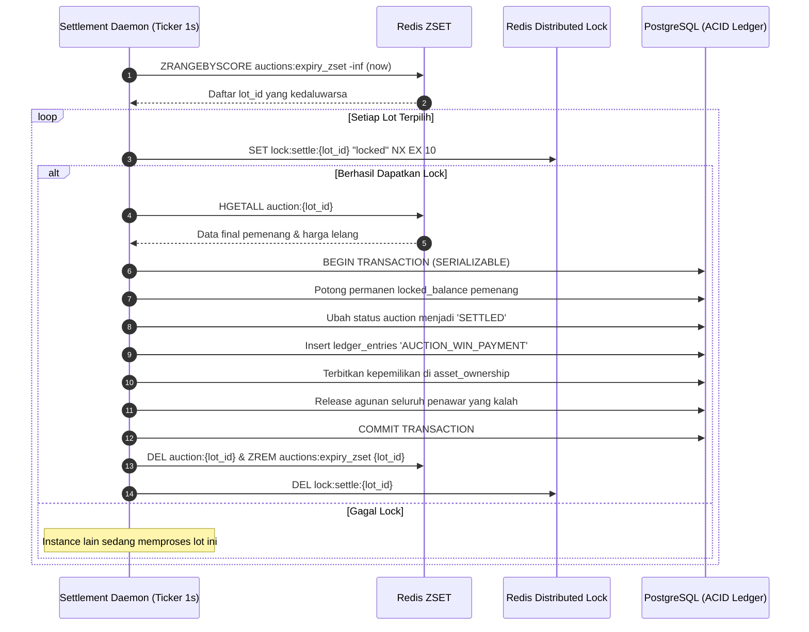
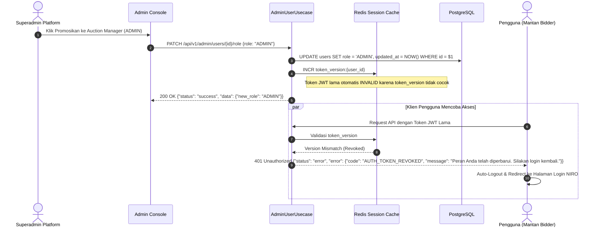
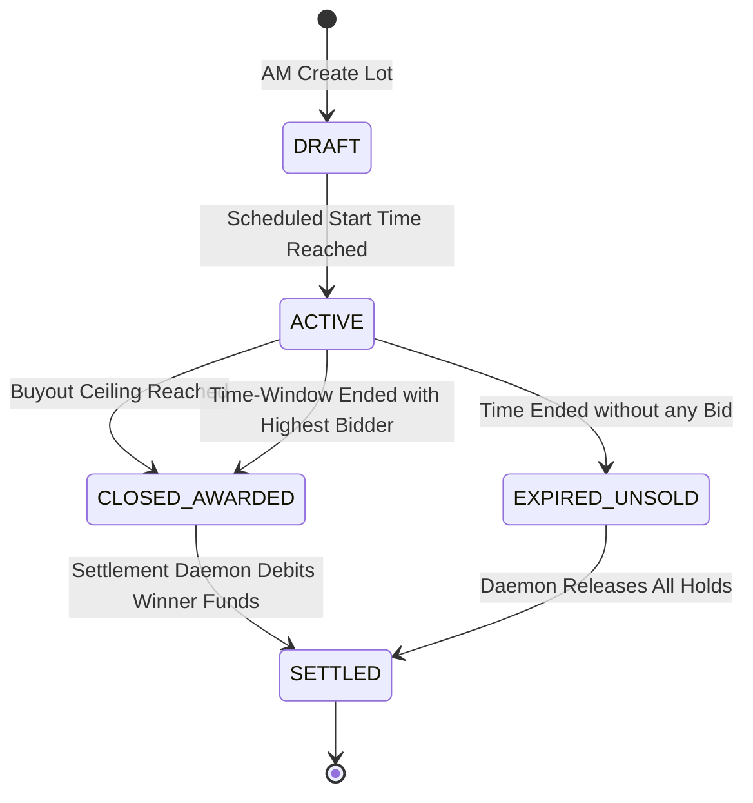

# LOW LEVEL DESIGN DOCUMENT
## Real-Time Luxury Auction Engine
### Core Engine, Bidding Lua & API Implementation

| Metadata | Value |
|---|---|
| **Prepared By :** | System Architecture & Delivery Team |
| **Date :** | 24 Oct 2026 |
| **Version :** | 1.0 |

---

## 1. Governance

### 1.1 Contributors
| Name | Position |
|---|---|
| Daniel H. S. | System Analyst / Solution Architect |
| Alini | Technical Lead |
| Geri Setyo Andrian | Project Manager |

### 1.2 Approvals
| Name | Position | Date | Signature |
|---|---|:---:|:---:|
| Geri Setyo Andrian | Project Manager Delivery Team | 24 Oct 2026 | `[ APPROVED & SIGNED ]` |
| Alini | Technical Architect / Tech Lead Delivery Team | 24 Oct 2026 | `[ APPROVED & SIGNED ]` |
| Daniel H. S. | System Analyst Delivery Team | 24 Oct 2026 | `[ APPROVED & SIGNED ]` |

### 1.3 Revision History
| Version | Date | Author | Summary of Changes |
|---|---|---|---|
| 0.1 | 24 Oct 2026 | Daniel H. S. | Initial Technical Draft (Components & Goroutines) |
| 0.5 | 24 Oct 2026 | Daniel H. S. | Added Lua Scripting Logic, Settlement Daemon, and 14 API Endpoints |
| 1.0 | 24 Oct 2026 | Daniel H. S. | Baseline Alignment with Enterprise Template Structure & Sign-Off |

---

## 2. Table of Contents
- [1. Governance](#1-governance)
  - [1.1 Contributors](#11-contributors)
  - [1.2 Approvals](#12-approvals)
  - [1.3 Revision History](#13-revision-history)
- [2. Table of Contents](#2-table-of-contents)
- [3. Introduction](#3-introduction)
  - [3.1 Low-Level Design Overview](#31-low-level-design-overview)
  - [3.2 Glossaries](#32-glossaries)
  - [3.3 Objective Overview](#33-objective-overview)
  - [3.4 References](#34-references)
- [4. System & Integration Landscape](#4-system--integration-landscape)
  - [4.1 Component Interaction](#41-component-interaction)
  - [4.2 Impacted Objects & Detailed Functionality](#42-impacted-objects--detailed-functionality)
- [5. Detailed Sequence Diagrams & Algorithms](#5-detailed-sequence-diagrams--algorithms)
  - [5.1 Incremental Bid Execution (bid_placement.lua)](#51-incremental-bid-execution-bid_placementlua)
  - [5.2 Settlement Daemon Expiry Flow](#52-settlement-daemon-expiry-flow)
- [6. Application Interfaces & API Contracts](#6-application-interfaces--api-contracts)
  - [6.1 Complete Endpoint Specifications](#61-complete-endpoint-specifications)
  - [6.2 WebSocket & Real-Time Event Bus](#62-websocket--real-time-event-bus)
- [7. In-Memory, Caching & Data Structures](#7-in-memory-caching--data-structures)
  - [7.1 In-Memory Atomic Scripts (Lua Engine)](#71-in-memory-atomic-scripts-lua-engine)
  - [7.2 Caching Key Schemas](#72-caching-key-schemas)
- [8. State Machine & Lifecycle Specifications](#8-state-machine--lifecycle-specifications)
- [9. Document Sign-Off Section](#9-document-sign-off-section)

---

## 3. Introduction

### 3.1 Low-Level Design Overview
Dokumen Low-Level Design (LLD) ini menguraikan spesifikasi implementasi perangkat lunak pada tingkat kode, skrip in-memory, antarmuka REST API, WebSocket pub/sub, dan state machine database untuk **Real-Time Luxury Auction Engine**.

### 3.2 Glossaries
| No | Terms | Expansion | Definition |
|---|---|---|---|
| 1 | **EVALSHA** | Evaluate SHA1 Digest | Perintah Redis untuk mengeksekusi skrip Lua yang telah di-cache server secara atomic. |
| 2 | **BYTEA** | Byte Array | Tipe data kolom PostgreSQL untuk menyimpan representasi biner gambar produk secara langsung. |
| 3 | **ZSET** | Sorted Set | Struktur data Redis berurutan berdasarkan score waktu untuk tracking expiry lelang. |
| 4 | **Base64** | Binary-to-Text Encoding | Skema representasi string data biner untuk transfer respons JSON ke antarmuka front-end. |

### 3.3 Objective Overview
Menyediakan instruksi teknis langsung bagi tim engineering untuk membangun modul Golang backend, mengonfigurasi skrip Redis Lua, dan menghubungkan Next.js web client sesuai standar kualitas TDD.

### 3.4 References
- **High-Level Design Document:** [`high-level-design.md`](file:///d:/Projects/Salt-Hackaton-2026/02_Projects/real-time-auction-engine/04_Design/high-level-design.md)
- **Database Schema & Redis Lua Design:** [`database-schema.md`](file:///d:/Projects/Salt-Hackaton-2026/02_Projects/real-time-auction-engine/06_Data_Design/database-schema.md)
- **API Contracts Specification:** [`api-contracts.md`](file:///d:/Projects/Salt-Hackaton-2026/02_Projects/real-time-auction-engine/05_Integration/api-contracts.md)

---

## 4. System & Integration Landscape

### 4.1 Component Interaction
Interaksi antar-komponen di dalam modul Golang dan external service:



### 4.2 Impacted Objects & Detailed Functionality
| No | Impact | Object Name | Functions |
|---|---|---|---|
| 1 | **New** | `internal/domain` | Definisi struct murni: `User`, `Wallet`, `Auction`, `Bid`, `LedgerEntry` (seluruh atribut moneter menggunakan `float64`). |
| 2 | **New** | `internal/usecase/bid` | Validasi kelipatan tombol bid diskrit, kalkulasi buy-out, pemicu Lua atomik. |
| 3 | **New** | `internal/usecase/auth` | Login NIRO SSO, progressive lockout Superadmin, serta **Token Revocation (Auto-Logout)** saat user dipromosikan ke `ADMIN`. |
| 4 | **New** | `internal/repository/redis`| Eksekusi EVALSHA `bid_placement.lua`, manajemen connection pool, ZSET expiry index, dan tracking `token_version:{user_id}`. |
| 5 | **New** | `internal/transport/ws` | Multiplexing koneksi WebSocket per lot lelang dan proteksi heart-beat ping/pong. |

---

## 5. Detailed Sequence Diagrams & Algorithms

### 5.1 Incremental Bid Execution (bid_placement.lua)



### 5.2 Settlement Daemon Expiry Flow



### 5.3 Role Promotion & Mandatory Auto-Logout Sequence

Ketika Superadmin mempromosikan user dari `BIDDER` menjadi `ADMIN` (Auction Manager), sesi lama user wajib dibatalkan seketika agar hak akses lama tidak disalahgunakan.



---

## 6. Application Interfaces & API Contracts

### 6.1 Complete Endpoint Specifications
Berikut adalah 14 endpoint implementasi transport API pada sistem:

| Method | Endpoint | Role | Penjelasan Fungsional & Kontrak |
|---|---|---|---|
| `GET`  | `/api/v1/auth/niro/authorize-url` | Publik | Mendapatkan redirect URL resmi NIRO SSO beserta CSRF state. |
| `POST` | `/api/v1/auth/login/niro` | Publik | Menerima `niro_token`. Jika baru, auto-register role `BIDDER`; jika sudah ada, buat session JWT. |
| `POST` | `/api/v1/auth/login/email` | Publik | Login email & password (min. 12 char) khusus `SUPERADMIN` dengan progressive lockout. |
| `GET`  | `/api/v1/admin/users` | `SUPERADMIN` | Mengambil daftar pengguna terdaftar NIRO (lengkap dengan pagination meta). |
| `PATCH`| `/api/v1/admin/users/:id/role` | `SUPERADMIN` | Mempromosikan role user dari `BIDDER` menjadi `ADMIN` (Auction Manager). |
| `GET`  | `/api/v1/wallet/me` | `BIDDER` | Mengambil informasi saldo likuid (`available_balance`) dan tertahan (`locked_balance`). |
| `POST` | `/api/v1/wallet/topup` | `BIDDER` | Menambah saldo e-wallet khusus penawar (minimal deposit Rp 100.000). |
| `GET`  | `/api/v1/auctions/active` | Publik | Daftar lot barang mewah aktif, pagination meta, dan thumbnail Base64 terkompresi. |
| `GET`  | `/api/v1/auctions/:id` | Publik | Detail lengkap lot, foto Base64 utuh, step increment tombol, dan jaminan keaslian. |
| `POST` | `/api/v1/auctions/:id/bids` | `BIDDER` | Mengirim penawaran tombol bertingkat diskrit; validasi instant buy-out & anti-sniping. |
| `POST` | `/api/v1/auctions/:id/proxy-bid` | `BIDDER` | Konfigurasi bot penawaran bertingkat dengan batas limit penawaran maksimal. |
| `DELETE`| `/api/v1/auctions/:id/proxy-bid` | `BIDDER` | Membatalkan konfigurasi bot proxy penawaran pada lot tertentu. |
| `POST` | `/api/v1/admin/auctions` | `ADMIN` | Membuat lot baru via form biner multipart (`image` disimpan di DB `BYTEA`), durasi extend lot. |
| `WS`   | `/api/v1/ws/auctions` | Universal | Channel WebSocket streaming mutasi harga, countdown timer, dan event lelang. |

### 6.2 WebSocket & Real-Time Event Bus
* **Protokol:** Dupleks penuh WebSocket JSON Frame.
* **Keep-Alive:** Klien mengirim `ping` setiap 30 detik; server menjawab `pong`.
* **Struktur Pesan Broadcast:**
```json
{
  "event": "PRICE_UPDATED",
  "data": {
    "lot_id": "9b1deb4d-3b7d-4bad-9bdd-2b0d7b3dcb6d",
    "current_price": 125000000,
    "highest_bidder_masked": "Us***78",
    "end_time": "2026-10-25T14:00:00Z",
    "is_extended": true
  }
}
```

---

## 7. In-Memory, Caching & Data Structures

### 7.1 In-Memory Atomic Scripts (Lua Engine)
Logika transaksi hot-path dijalankan secara atomik melalui skrip `bid_placement.lua`:
- Validasi status lot lelang (`ACTIVE`).
- Verifikasi saldo `available_balance >= target_bid`.
- Pemotongan `available_balance` dan pemindahan dana ke `locked_balance`.
- *Catatan Bisnis:* Dana penawar sebelumnya tetap tersimpan di `locked_balance` hingga lelang mencapai settlement akhir.
- Penghitungan lonjakan velositas penawaran dalam jendela 2 menit terakhir (jika $\ge 10\text{ bid/s}$, perpanjang `end_time`).

### 7.2 Caching Key Schemas
* `auction:{lot_id}` (Type: `HASH`): Status lot lelang, harga terkini, waktu berakhir, ceiling valuation.
* `wallet:{user_id}` (Type: `HASH`): Saldo bebas (`available_balance`) dan tertahan (`locked_balance`).
* `auctions:expiry_zset` (Type: `ZSET`): Indexing lelang aktif dengan score `end_time` epoch timestamp.
* `lockout:superadmin:{email}` (Type: `STRING`): TTL counter progressive lockout email superadmin.

---

## 8. State Machine & Lifecycle Specifications



---

## 9. Document Sign-Off Section

Dokumen perancangan tingkat rendah (*Low-Level Design*) ini telah ditinjau secara mendalam dari segi kelayakan teknis, struktur data, algoritma usecase, dan kesiapan pengujian TDD, serta secara resmi disahkan untuk tahap koding.

| Peran & Tanggung Jawab | Nama Pejabat | Status Persetujuan | Tanggal |
|---|---|:---:|:---:|
| **Project Manager** | **Geri Setyo Andrian** | `[ APPROVED & SIGNED ]` | 2026-10-24 |
| **Tech Lead** | **Alini** | `[ APPROVED & SIGNED ]` | 2026-10-24 |
| **System Analyst** | **Daniel H. S.** | `[ APPROVED & SIGNED ]` | 2026-10-24 |
