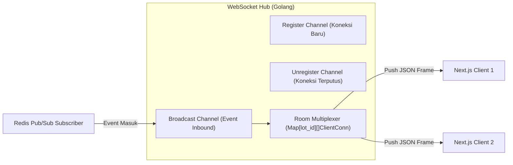

# Low-Level Design (LLD) — Real-Time Luxury Auction Engine

| Metadata | Nilai |
|---|---|
| **Dokumen** | Low-Level Design (LLD) & Component Specifications |
| **Proyek** | Real-Time Auction & Bidding Engine (Fintech / E-Commerce) |
| **Versi** | v1.0.0 |
| **Status** | `Approved Baseline` |
| **Tanggal** | 2026-10-24 |
| **Target Komponen** | Golang Domain, Usecase, Redis Lua Engine, dan WebSocket Hub |

---

## 1. Spesifikasi Model Domain (Golang Structs)

Lapisan domain tidak memiliki dependensi eksternal (*pure business entities*):

```go
package domain

import (
	"time"
	"github.com/google/uuid"
)

type UserRole string
const (
	RoleBidder     UserRole = "BIDDER"
	RoleAdmin      UserRole = "ADMIN"
	RoleSuperAdmin UserRole = "SUPERADMIN"
)

type AuthProvider string
const (
	ProviderNiro     AuthProvider = "NIRO"
	ProviderInternal AuthProvider = "INTERNAL"
)

type User struct {
	ID           uuid.UUID    `json:"id"`
	AuthProvider AuthProvider `json:"auth_provider"`
	NiroUserID   *string      `json:"niro_user_id,omitempty"`
	Username     string       `json:"username"`
	Email        string       `json:"email"`
	PasswordHash *string      `json:"-"`
	Role         UserRole     `json:"role"`
	CreatedAt    time.Time    `json:"created_at"`
	UpdatedAt    time.Time    `json:"updated_at"`
}

type Wallet struct {
	ID               uuid.UUID `json:"id"`
	UserID           uuid.UUID `json:"user_id"`
	AvailableBalance float64   `json:"available_balance"`
	LockedBalance    float64   `json:"locked_balance"`
	Version          int64     `json:"version"`
	UpdatedAt        time.Time `json:"updated_at"`
}

type AuctionModel string
const (
	ModelUncapped AuctionModel = "UNCAPPED"
	ModelCapped   AuctionModel = "CAPPED"
)

type AuctionStatus string
const (
	StatusDraft         AuctionStatus = "DRAFT"
	StatusActive        AuctionStatus = "ACTIVE"
	StatusClosedAwarded AuctionStatus = "CLOSED_AWARDED"
	StatusSettled       AuctionStatus = "SETTLED"
	StatusExpiredUnsold AuctionStatus = "EXPIRED_UNSOLD"
)

type AssetCategory string
const (
	CatWatches     AssetCategory = "LUXURY_WATCHES"
	CatBags        AssetCategory = "DESIGNER_BAGS"
	CatJewelry     AssetCategory = "FINE_JEWELRY"
	CatVehicles    AssetCategory = "COLLECTIBLE_VEHICLES"
	CatMemorabilia AssetCategory = "RARE_MEMORABILIA"
)

type Auction struct {
	ID                     uuid.UUID     `json:"id"`
	Title                  string        `json:"title"`
	Category               AssetCategory `json:"category"`
	ConditionGrade         string        `json:"condition_grade"`
	AuthenticityGuarantee  string        `json:"authenticity_guarantee"`
	Description            string        `json:"description"`
	ImageURL               string        `json:"image_url"`
	ModelType              AuctionModel  `json:"model_type"`
	Status                 AuctionStatus `json:"status"`
	StartingPrice          float64       `json:"starting_price"`
	CurrentPrice           float64       `json:"current_price"`
	MinIncrement           float64       `json:"min_increment"`
	AllowedIncrementSteps  []float64     `json:"allowed_increment_steps"`
	ValuationCeiling       *float64      `json:"valuation_ceiling,omitempty"`
	AntiSnipingExtensionMin *int         `json:"anti_sniping_extension_minutes,omitempty"`
	StartTime              time.Time     `json:"start_time"`
	EndTime                time.Time     `json:"end_time"`
	OriginalEndTime        time.Time     `json:"original_end_time"`
	HighestBidderID        *uuid.UUID    `json:"highest_bidder_id,omitempty"`
	CreatedBy              uuid.UUID     `json:"created_by"`
	CreatedAt              time.Time     `json:"created_at"`
	UpdatedAt              time.Time     `json:"updated_at"`
}
```

---

## 2. Rincian Logika Usecase (Application Layer)

### 2.1 BidUsecase: PlaceBid (Orkestrasi Penawaran Inkremental)
Algoritma pemrosesan penawaran:
1. **Validasi Awal Payload:** Pastikan nominal kenaikan (*increment*) sesuai dengan salah satu angka pada array `allowed_increment_steps` milik lot, atau request merupakan aksi *Buyout Langsung*.
2. **Pengecekan Saldo di Redis:** Periksa hash `wallet:{user_id}`. Pastikan `available_balance >= target_bid`.
3. **Eksekusi Atomik Lua Script (`bid_placement.lua`):**
   - Menguji apakah status lot masih `ACTIVE` dan `now < end_time`.
   - Mengurangi `available_balance` penawar baru dan memindahkannya ke `locked_balance` (saldo tertahan).
   - *(Pemberitahuan Penting: Saldo penawar sebelumnya TIDAK dilepaskan saat tersalip, melainkan tetap terkunci/tertahan sampai periode lelang selesai).*
   - Memeriksa apakah `now >= end_time - 15s` (Anti-Sniping). Jika ya, menambahkan `end_time = end_time + 30s` (dengan proteksi batas maksimal).
   - Memeriksa apakah `target_bid >= valuation_ceiling` (Capped Model). Jika ya, langsung ubah status lot menjadi `CLOSED_AWARDED`.
4. **Penerbitan Event Real-Time:** Menulis pesan ke Redis Pub/Sub channel `channel:auction:events` untuk disiarkan oleh WebSocket Hub ke seluruh client dalam < 300 ms.
5. **Persistensi Asinkron:** Menyimpan riwayat penawaran ke tabel PostgreSQL `bids`.

### 2.2 SettleUsecase: Automatic Expiry Settlement
Algoritma pekerja latar belakang (*settlement daemon*):
1. Mengambil lot yang expired dari Redis Sorted Set: `ZRANGEBYSCORE auctions:expiry_zset -inf now()`.
2. Mengambil *distributed lock* untuk lot tersebut: `SETNX lock:settle:{lot_id} "locked" EX 10`. Jika gagal mendapatkan lock, lewati (sudah ditangani instance lain).
3. Mengecek data penawar tertinggi dari Redis `auction:{lot_id}`.
4. Membuka transaksi database PostgreSQL:
   - Jika ada penawar tertinggi: Ubah status lelang menjadi `SETTLED`, potong permanen `locked_balance` pemenang, catat entri mutasi ledger `AUCTION_WIN_PAYMENT`, dan terbitkan baris di tabel `asset_ownership`.
   - Jika tidak ada penawar: Ubah status lelang menjadi `EXPIRED_UNSOLD`.
   - Pastikan seluruh agunan peserta lain berstatus 0 locked.
5. Menghapus key lelang aktif dari Redis dan memancarkan event `AUCTION_CONCLUDED` via WebSocket.

---

## 3. Desain Komponen WebSocket Hub

WebSocket Hub bertugas mempertahankan ribuan koneksi persisten peserta dan mendistribusikan pembaruan harga secara non-blocking:



* **Heartbeat & Keep-Alive:** Client mengirimkan frame ping setiap 30 detik. Jika server tidak menerima pong dalam 60 detik, koneksi ditutup secara bersih (*graceful cleanup*).
* **Multiplexing Room:** Client mendaftarkan diri hanya pada lot yang sedang ditonton (`SUBSCRIBE_LOT`) untuk menghemat bandwidth, ditambah satu channel global untuk update etalase katalog.

---

## 4. Ikhtisar Endpoint List (Penjelasan Ringkas)

Berikut adalah penjelasan fungsional seluruh rute endpoint yang diimplementasikan pada lapisan Transport HTTP:

| Method | Endpoint | Hak Akses | Penjelasan Fungsional |
|---|---|---|---|
| `POST` | `/api/v1/auth/login-niro` | Publik | Handshake SSO dengan sistem NIRO; auto-provision akun dan dompet peserta jika user baru. |
| `POST` | `/api/v1/auth/login-superadmin` | Publik | Otentikasi khusus Superadmin platform menggunakan username & password internal Bcrypt. |
| `GET` | `/api/v1/admin/users` | `SUPERADMIN` | Mengambil daftar pengguna login NIRO untuk kebutuhan tata kelola peran platform. |
| `PATCH`| `/api/v1/admin/users/:id/role` | `SUPERADMIN` | Mengubah hak akses pengguna NIRO menjadi `ADMIN` (Auction Manager). |
| `GET` | `/api/v1/wallet/me` | `Authenticated` | Mengembalikan status saldo bebas (*Available*) dan saldo tertahan (*Locked*). |
| `POST` | `/api/v1/wallet/topup` | `Authenticated` | Menambahkan saldo likuid bebas ke dompet untuk modal penawaran lelang. |
| `GET` | `/api/v1/auctions/active` | Publik | Mengambil daftar lot lelang barang mewah yang sedang aktif dalam tahap penemuan harga. |
| `GET` | `/api/v1/auctions/:id` | Publik | Mengambil detail spesifikasi barang mewah, jaminan keaslian, dan riwayat tawaran lot. |
| `POST` | `/api/v1/auctions/:id/bids` | `BIDDER/ADMIN` | Mengirim penawaran inkremental tombol pilihan (atau buyout langsung); memicu penguncian agunan instan. |
| `POST` | `/api/v1/auctions/:id/proxy-bid` | `BIDDER/ADMIN` | Menyetel bot penawaran otomatis dengan batas limit maksimal personal. |
| `DELETE`| `/api/v1/auctions/:id/proxy-bid` | `BIDDER/ADMIN` | Membatalkan / menonaktifkan aturan bot proxy penawaran pada lot tertentu. |
| `POST` | `/api/v1/admin/auctions` | `ADMIN` | Membuat listing lot lelang barang mewah baru, menetapkan harga minimal, opsi harga maksimal, dan durasi jendela waktu (misal 1 hari). |
| `GET` | `/api/v1/admin/configs` | `ADMIN` | Mengambil konfigurasi dinamis platform (waktu anti-sniping dan batas akumulasi perpanjangan). |
| `PUT` | `/api/v1/admin/configs` | `ADMIN` | Mengubah parameter waktu operasional sistem secara dinamis (*live hot-reload* ke Redis). |
| `WS` | `/api/v1/ws/auctions` | Publik / Auth | Jalur koneksi real-time WebSocket untuk menerima siaran event harga, timer, buyout, dan settlement. |
