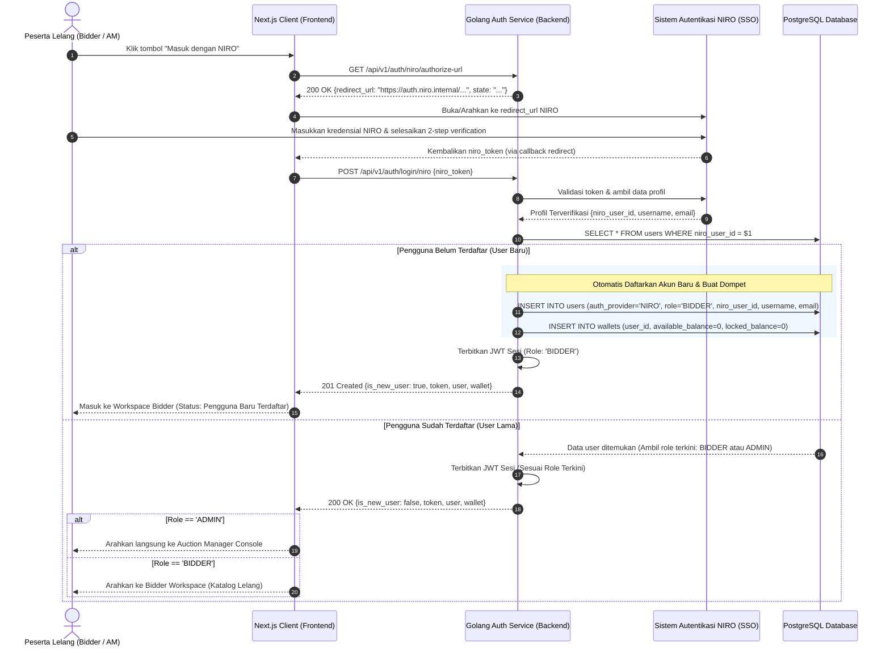
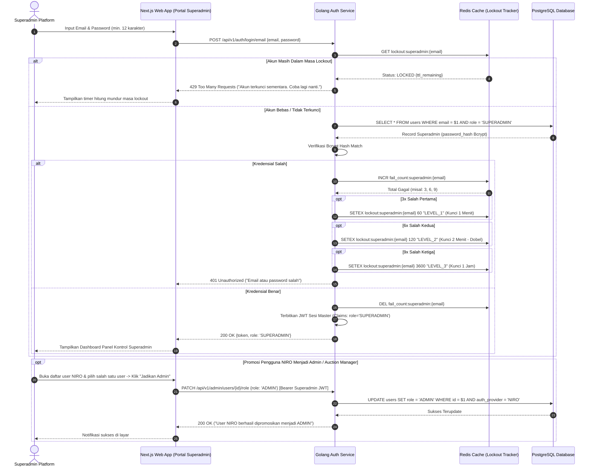
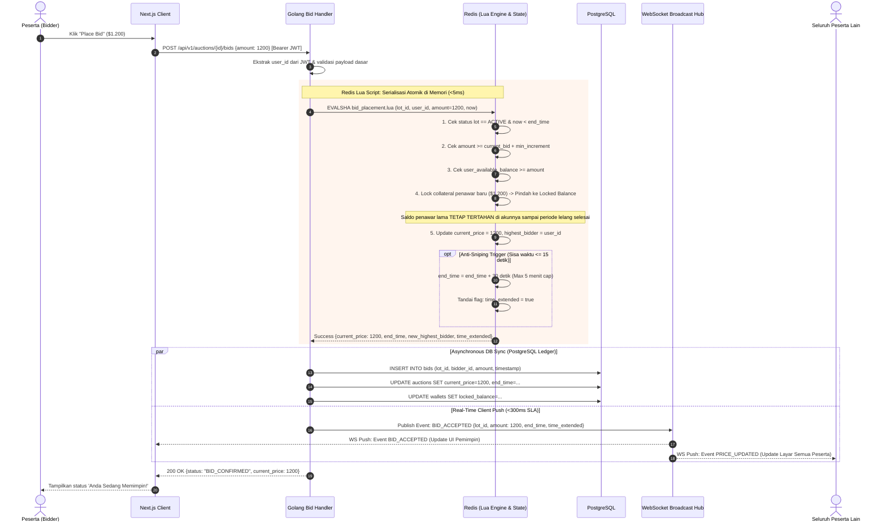
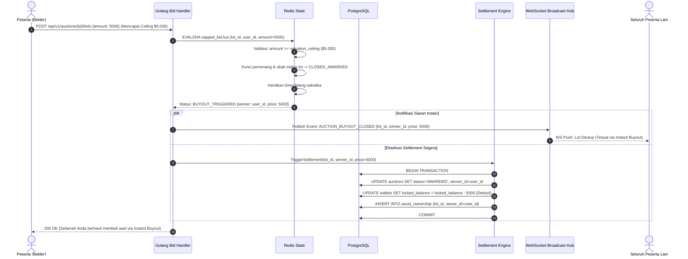
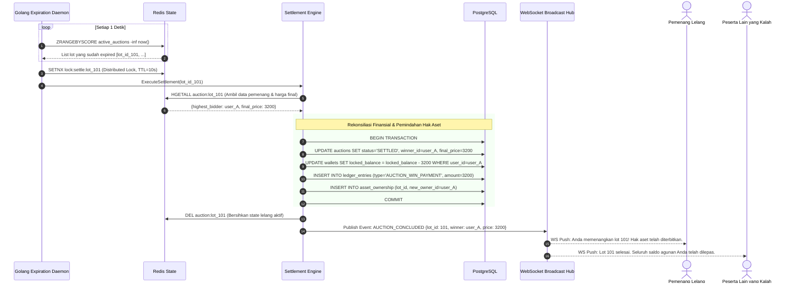

# Diagram Urutan Interaksi (Sequence Diagrams) — Fase 1 (Core / MVP)

| Metadata | Nilai |
|---|---|
| **Dokumen** | Sequence Diagrams (MVP 1 Baseline) |
| **Proyek** | Real-Time Auction & Bidding Engine |
| **Tipe Dokumen** | Perancangan Arsitektur & Interaksi Sistem (Technical Design) |
| **Versi** | v0.1.0 |
| **Status** | `Draft` (Dalam Perancangan) |
| **Tanggal** | 2026-10-24 |
| **Target SLA** | Latensi Sinkronisasi < 300 ms, Nol Race Condition |

---

## 1. Sequence Diagram: Arsitektur Dual-Login (NIRO SSO vs Superadmin Internal)

### 1.1 Jalur 1: Login with NIRO (Khusus Peserta Lelang / Bidder & Auction Manager)
Alur otentikasi lengkap: FE meminta URL redirect ke BE $\rightarrow$ FE membuka halaman NIRO $\rightarrow$ Pengguna login di NIRO $\rightarrow$ FE menerima token NIRO $\rightarrow$ FE mengirim token ke BE $\rightarrow$ BE cek apakah user sudah ada (jika belum didaftarkan, jika sudah diloginkan).

---

### 1.2 Jalur 2: Login Superadmin via Email & Password dengan Progressive Lockout
Jalur login terproteksi khusus Superadmin dengan proteksi lockout berlipat ganda (*exponential backoff*).

---

## 2. Sequence Diagram: Penawaran Manual Atomik & Anti-Sniping (FEAT-004 + FEAT-007)

Ini adalah jalur interaksi paling kritis (*the hot-path*). Menggunakan **Redis Lua Script** untuk menjamin atomisitas, ketiadaan *race condition*, dan pemenuhan SLA latensi < 300 ms.

---

## 3. Sequence Diagram: Pembelian Instan Model Capped Value (FEAT-006)

Interaksi saat penawaran masuk menyamai atau melampaui batas valuasi (*ceiling*). Hitung mundur lelang langsung dihentikan dan hak aset dikunci.

---

## 4. Sequence Diagram: Penutupan Waktu & Rekonsiliasi Otomatis (FEAT-008)

Interaksi latar belakang saat lot model *Uncapped* habis waktunya (*timer = 0*).

