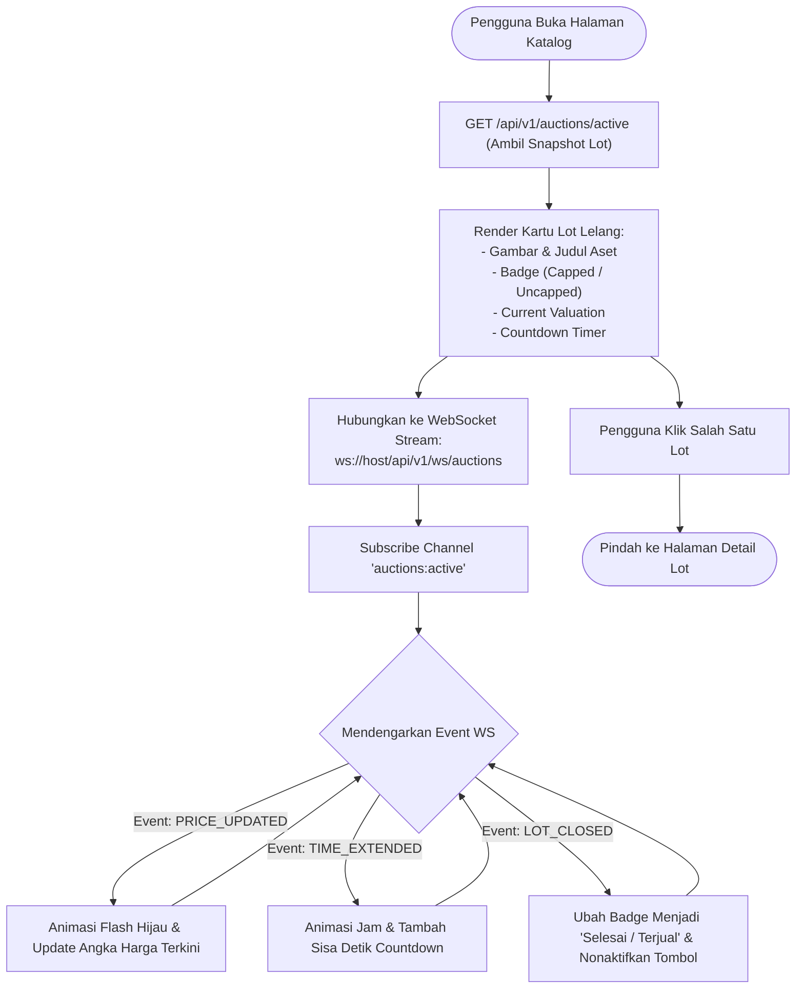
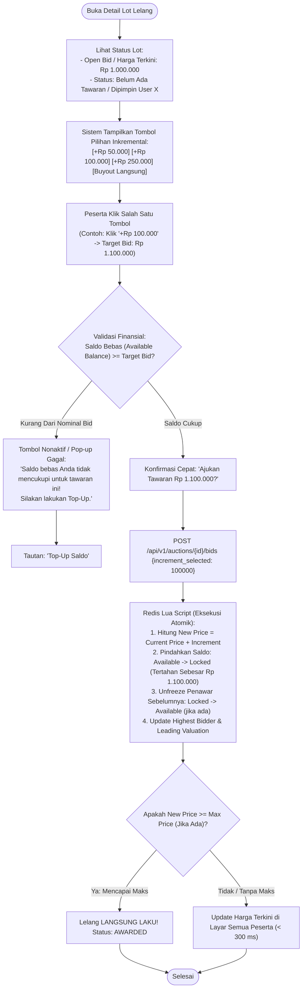
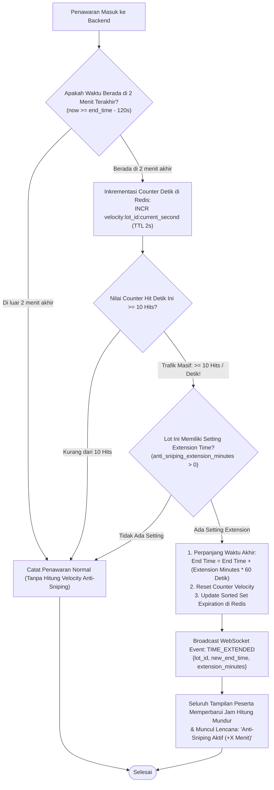
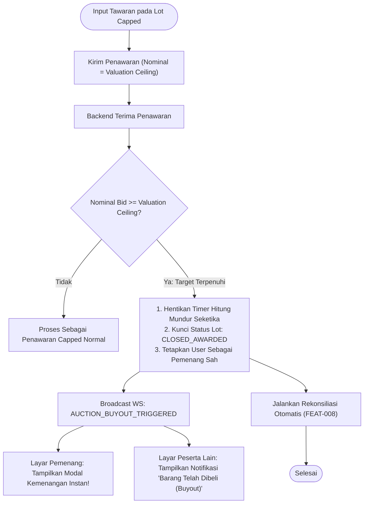
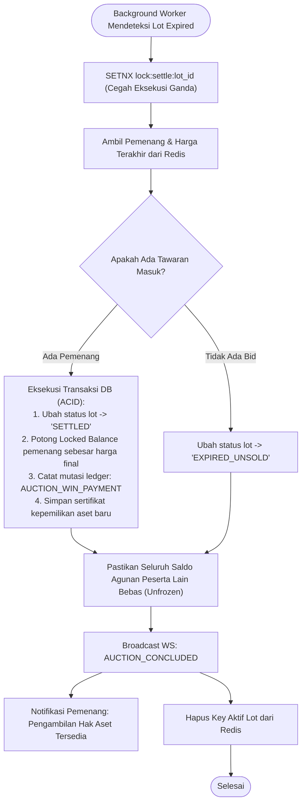
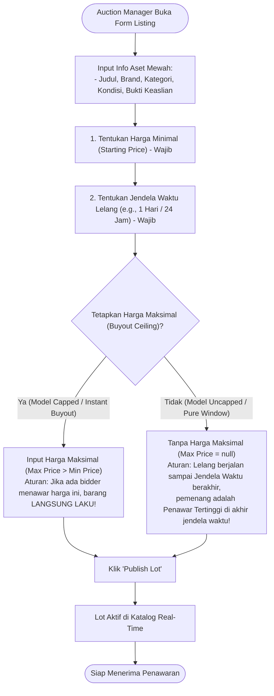

# Spesifikasi User Flow per Fitur — Fase 1 (Core / MVP)

| Metadata | Nilai |
|---|---|
| **Dokumen** | User Flows per Fitur (MVP 1 Baseline) |
| **Proyek** | Real-Time Auction & Bidding Engine |
| **Tipe Dokumen** | Desain Fungsional & Interaksi (Functional Design) |
| **Versi** | v0.1.0 |
| **Status** | `Draft` (Dalam Perancangan) |
| **Tanggal** | 2026-10-24 |
| **Sistem Utama** | Next.js (Frontend), Golang (Backend), Redis & PostgreSQL |

---

## Daftar Isi Fitur MVP 1

1. [FEAT-001: Registrasi Akun & Inisialisasi Dompet Agunan](#feat-001-registrasi-akun--inisialisasi-dompet-agunan)
2. [FEAT-002: Eksplorasi Katalog Dinamis & Live State](#feat-002-eksplorasi-katalog-dinamis--live-state)
3. [FEAT-004 + FEAT-003: Penawaran Manual Atomik & Penguncian Agunan](#feat-004--feat-003-penawaran-manual-atomik--penguncian-agunan)
4. [FEAT-007: Perpanjangan Waktu Dinamis (Anti-Sniping)](#feat-007-perpanjangan-waktu-dinamis-anti-sniping)
5. [FEAT-006: Pembelian Instan Model Capped Value (Instant Buyout)](#feat-006-pembelian-instan-model-capped-value-instant-buyout)
6. [FEAT-008: Penyelesaian Akhir & Pelepasan Agunan (Settlement)](#feat-008-penyelesaian-akhir--pelepasan-agunan-settlement)
7. [FEAT-009: Pembuatan Listing Lot Lelang (Admin Catalog Curation)](#feat-009-pembuatan-listing-lot-lelang-admin-catalog-curation)

---

## FEAT-001: Autentikasi Pengguna Terpisah & Progressive Lockout

### 1. Deskripsi & Ketentuan Fitur Autentikasi
1. **Fitur yang Di-takeout / Dihapus:**
   - Fitur **Forgot Password** ditiadakan (tidak diimplementasikan).
   - Fitur **Kickout Sesi Otomatis** ditiadakan.
2. **Jalur 1: Login with NIRO (Khusus Bidder & Auction Manager):**
   * Pengguna mengklik tombol *"Masuk dengan NIRO"*.
   * Menggunakan autentikasi Single Sign-On (SSO) dari sistem NIRO. Jika mencoba login via form email/password, sistem menolak dan menginstruksikan penggunaan NIRO.
3. **Jalur 2: Login with Email & Password (Khusus Superadmin):**
   * Masuk menggunakan **Email dan Password** (minimal 12 karakter).
   * **Aturan Penguncian Bertingkat (*Progressive Lockout Policy*):**
     - **3x salah pertama:** Wajib menunggu **1 menit**.
     - **3x salah kedua (total 6x):** Waktu tunggu berlipat ganda menjadi **2 menit**.
     - **3x salah ketiga (total 9x):** Wajib menunggu selama **1 jam (60 menit)**.

---

### 2. Diagram Antarmuka & Alur Dual-Login (UI Interaction Flow)

```mermaid
flowchart TD
    Start(["Layar Sign In"]) --> ChoiceUI{"Pilih Metode Login"}
    
    %% Jalur NIRO
    ChoiceUI -->|"Tombol 'Login with NIRO'"| NiroFlow["Autentikasi SSO NIRO & 2-Step Verification"]
    NiroFlow --> ValNiro{"Hasil Validasi NIRO?"}
    ValNiro -->|Gagal/Dibatalkan| ErrNiro["Tolak Akses & Tetap di Sign In Page"]
    ValNiro -->|Sukses| CheckRole{"Cek Role di Database"}
    CheckRole -->|Role BIDDER| WorkspaceBidder["Arahkan ke Bidder Workspace"]
    CheckRole -->|Role ADMIN| WorkspaceAdmin["Arahkan ke Auction Manager Workspace"]

    %% Percobaan Salah Jalur oleh Bidder/Admin
    ChoiceUI -->|"Bidder/Admin Coba Isi Form Email & Password"| BlockNonSuper["Sistem Tolak Permintaan:\n'Akun Anda terdaftar sebagai Peserta/Manager. Silakan gunakan tombol Login with NIRO.'"]

    %% Jalur Superadmin
    ChoiceUI -->|"Form Khusus Superadmin"| SuperForm["Input Email & Password (Min. 12 Karakter)"]
    SuperForm --> CheckLock{"Apakah Akun Sedang Dalam Masa Lockout?"}
    CheckLock -->|Ya: Sedang Masa Tunggu| ShowLockMsg["Tampilkan Pesan Lockout:\n'Terlalu banyak percobaan gagal. Silakan tunggu X detik/menit.'"]
    
    CheckLock -->|Tidak Terkunci| PostSuper["POST /api/v1/auth/login-superadmin"]
    PostSuper --> VerifyCred{"Kredensial Email & Password Valid?"}
    
    VerifyCred -->|Sah| ResetCounter["Reset Counter Gagal -> Berikan Akses Superadmin"]
    ResetCounter --> SuperWorkspace["Arahkan ke Superadmin Workspace"]
    
    VerifyCred -->|Salah| IncrFail["Inkrementasi Counter Gagal (Redis: fail:email)"]
    IncrFail --> EvalFail{"Evaluasi Jumlah Gagal Berturut-turut"}
    
    EvalFail -->|3x Salah Pertama| Lock1["Kunci Akun Selama 1 Menit!"]
    EvalFail -->|6x Salah (3x Kedua)| Lock2["Kunci Akun Selama 2 Menit (Dobel Waktu)!"]
    EvalFail -->|9x Salah (3x Ketiga)| Lock3["Kunci Akun Selama 1 Jam (60 Menit)!"]
    EvalFail -->|1x atau 2x Salah| GenericErr["Tampilkan Pesan: 'Email atau password salah'"]
```

### 4. Detail Matriks Hak Akses Peran & Menu (RBAC)

| Menu / Aksi Fitur di Aplikasi | Bidder (Peserta) | Auction Manager (AM) | Super Admin | Penjelasan Aturan Bisnis |
|---|:---:|:---:|:---:|---|
| **Otentikasi Akun** | Login NIRO | Login NIRO | Email & Password | Bidder & AM via SSO NIRO; Superadmin via Email & Password internal. |
| **Menu E-Wallet & Top-Up (Min. Rp 100k)** | ✅ | ❌ | ❌ | **Hanya Bidder** yang bisa top-up & punya saldo agunan menawar. |
| **Katalog Barang Mewah & Detail Lot** | ✅ | ✅ | ✅ | Dapat diakses semua peran. |
| **Menu Pasang Aturan Bid (Kelipatan/Limit)** | ❌ | ✅ | ✅ | **Hanya AM** (dan Superadmin) saat mengonfigurasi listing lot lelang. |
| **Aksi Bidding (Kirim Tawaran & Set Proxy)** | ✅ | ❌ | ❌ | **Hanya Bidder** yang melakukan aksi penawaran di ruang lelang. |
| **Menu Buat Listing Lot Lelang Baru** | ❌ | ✅ | ✅ | Hak kurasi katalog ada pada Auction Manager. |
| **Menu Live Bid Monitoring Stream** | ✅ | ✅ | ✅ | **Bisa diakses ketiganya** secara transparan untuk memantau aktivitas tawar. |
| **Menu Pengawasan Settlement** | ❌ | ✅ | ✅ | Pengawasan penyelesaian aset & audit pelepasan dana. |
| **Menu Assign Role (Promosikan AM)** | ❌ | ❌ | ✅ | Hak prerogatif Superadmin untuk mengangkat user NIRO jadi AM. |
| **Menu Pengaturan Parameter Sistem** | ❌ | ❌ | ✅ | Superadmin mengatur konfigurasi waktu global & sistem. |

### 4. Detail Langkah & Validasi

| Langkah | Aksi Pengguna | Respon Sistem | Penanganan Error / Validasi |
|---|---|---|---|
| **1. Form Input** | Memasukkan Nama, Email, dan Password ($\ge$ 6 karakter). | Menampilkan validasi visual real-time (hijau jika valid). | Cegah karakter ilegal dan format email invalid. |
| **2. Submit Form** | Mengklik tombol submit pendaftaran. | Tombol berubah menjadi *loading state* (mencegah klik ganda). | *Debounce* dan nonaktifkan tombol submit selama request berlangsung. |
| **3. Transaksi DB** | - | Backend mengeksekusi pembuatan user + dompet saldo dalam satu transaksi PostgreSQL. | Jika salah satu gagal, seluruh transaksi di-*rollback*. |
| **4. Penyimpanan Sesi** | - | Browser menyimpan token JWT dan state saldo di memori global client. | Token kedaluwarsa diarahkan ke halaman login. |

---

## FEAT-002: Eksplorasi Katalog Dinamis & Live State

### 1. Deskripsi & Nilai Bisnis
Menyajikan etalase lot lelang interaktif yang menampilkan status harga terkini, waktu hitung mundur (*countdown*), dan jenis lelang secara *real-time* tanpa perlu merefresh halaman.

### 2. Aktor & Prasyarat
* **Aktor:** Peserta (*Bidder*) & Observer.
* **Prasyarat:** Pengguna berada di halaman utama lelang.

### 3. Diagram Alur Pengguna (User Flow)



### 4. Detail Langkah & Validasi

| Langkah | Aksi Pengguna | Respon Sistem | Penanganan Error / Validasi |
|---|---|---|---|
| **1. Initial Fetch** | Mengakses URL `/auctions`. | Mengambil daftar lot berstatus `ACTIVE` dari endpoint REST. | Tampilkan skeleton loader selama data diunduh. |
| **2. WebSocket Handshake** | - | Browser membuka koneksi WebSocket persisten ke Golang backend. | Jika WS putus, lakukan auto-reconnect dengan *exponential backoff*. |
| **3. Live Sync** | Mengamati kartu lot. | State harga dan timer di layar terupdate otomatis begitu event diterima dari server (<300 ms). | Hitung mundur sinkron dengan jam server, bukan jam lokal laptop user. |

---

## Paradigma Finansial Baru: Saldo Tertahan Dinamis Saat Bidding (Dynamic Hold on Bid)

Sistem memberlakukan aturan likuiditas yang murni berbasis transaksi lelang:

1. **Tidak Ada Saldo Minimum Mengendap:**
   * Pengguna **tidak diwajibkan** memiliki saldo mengendap/tertahan pasif di akunnya saat mendaftar. Seluruh dana yang dimiliki pengguna adalah saldo bebas (*Available Balance*) 100%.
2. **Saldo Baru Tertahan Saat Mengajukan Bidding (*Hold Collateral on Bid*):**
   * Saldo baru akan dipindahkan menjadi **TERTAHAN / TERKUNCI (*Locked Collateral*)** tepat pada saat pengguna mengirimkan penawaran (*submit bid*).
   * Besaran saldo yang tertahan adalah **persis sebesar nominal penawaran** yang sedang diajukan.
   
   *Contoh Skenario Finansial:*
   * Pengguna memiliki saldo bebas: **Rp 100.000**.
   * Pengguna menawar sebuah jam tangan mewah sebesar: **Rp 75.000**.
   * Karena saldo bebas ($100.000$) $\ge$ nominal tawaran ($75.000$), penawaran **DITERIMA**!
   * Seketika tombol submit ditekan:
     - **Saldo Tertahan (*Locked*):** Rp 75.000 (mengikat penawaran aktif ini).
     - **Sisa Saldo Bebas (*Available*):** Rp 25.000 ($100.000 - 75.000$).
3. **Pelepasan vs Pemotongan Saldo Tertahan:**
   * **Saldo Tertahan Sampai Lelang Selesai:** Saldo penawar yang sudah terkunci saat bidding **TIDAK langsung dilepas ketika tersalip lawan (*no instant unfreeze on outbid*)**. Dana tersebut tetap berstatus tertahan (*Locked*) hingga **seluruh periode lelang pada lot tersebut berakhir secara sah** (waktu habis pada Uncapped atau Buyout tercapai pada Capped).
   * **Jika Menang Lelang (*Settled*):** Saat periode lelang selesai dan pengguna dinyatakan menang, dana tertahan dipotong permanen (*settled/deducted*) sebagai pembayaran resmi perolehan aset.
   * **Jika Kalah Lelang (*Final Release for Losers*):** Baru pada saat periode lelang lot tersebut dinyatakan selesai (*concluded*), dana jaminan milik peserta yang kalah dilepaskan 100% kembali ke saldo bebas (*Available Balance*).

---

## FEAT-004 + FEAT-003: Penawaran Inkremental Tombol Pilihan & Penguncian Agunan (Hold on Bid)

### 1. Deskripsi & Nilai Bisnis
Meniadakan input teks bebas untuk mencegah kesalahan ketik manual (*typo*) atau penawaran receh. Seluruh proses penawaran menggunakan **Sistem Inkremental Tombol Pilihan** (*Discrete Step Increments*).

### 2. Parameter Inkremental pada Lot Lelang
Saat Auction Manager membuat listing barang mewah, ditentukan:
* **Open Bid (Starting / Min Price):** Harga awal buka lelang (misal: Rp 100.000).
* **Max Price (Optional):** Jika dipilih/ditekan langsung laku.
* **Pilihan Kenaikan Inkremental (*Increment Options*):** Tombol-tombol kelipatan resmi yang dapat dipilih peserta, misalnya:
  - `+Rp 10.000`
  - `+Rp 25.000`
  - `+Rp 50.000`
  - `+Rp 100.000`
  - Atau tombol instan: **"Buyout Langsung (Harga Maks)"** (jika ada).

### 3. Diagram Alur Pengguna (User Flow Inkremental)



### 4. Detail Langkah & Validasi

| Langkah | Aksi Pengguna | Respon Sistem | Penanganan Error / Validasi |
|---|---|---|---|
| **1. Input Penawaran** | Mengetik angka atau mengklik tombol `+$100`. | Input memvalidasi agar tidak di bawah `Current Price + Min Increment`. | Tombol tidak bisa diklik jika angka di bawah aturan minimum. |
| **2. Validasi Agunan** | - | Sistem memastikan `Available Balance >= Amount`. | Mencegah penawaran tanpa jaminan dana (*collateral buffer*). |
| **3. Penguncian Atomik** | Klik tombol tawaran. | Redis memproses penawaran secara serial di memori dalam < 5 ms. | Mencegah tabrakan dua tawaran yang masuk pada milidetik yang sama. |
| **4. Restorasi Penawar Lama** | - | Saldo agunan milik penawar tertinggi sebelumnya otomatis dikembalikan ke *Available*. | Peserta yang tersalip bisa langsung menawar kembali tanpa uang tertahan. |

---

## FEAT-007: Perpanjangan Waktu Dinamis (Anti-Sniping Engine: Velocity-Based)

### 1. Deskripsi & Nilai Bisnis
Mencegah taktik curang *bid sniping* dan spekulasi liar di detik-detik akhir penutupan lelang dengan memantau **kecepatan penawaran (*submission velocity*)**. Jika pasar sedang sangat bergairah dan padat pada masa kritis, durasi lelang otomatis diperpanjang sesuai parameter yang telah dikonfigurasi saat pembuatan lot.

### 2. Aturan & Parameter Algoritma Anti-Sniping
1. **Zona Pemicu (*Trigger Critical Zone*):** Aktif hanya pada **2 menit terakhir** sebelum waktu lelang berakhir (`now >= end_time - 120s`).
2. **Kepadatan Trafik (*Velocity Hit Rate Threshold*):** Pengecekan per detik pada Redis. Jika dalam **1 detik terdapat $\ge$ 10 penawaran masuk (*10 hits/sec*)**, sistem seketika memicu perpanjangan waktu.
3. **Besaran Nilai Perpanjangan (*Custom Extension Duration*):** Ditentukan oleh Auction Manager saat membuat lot lelang (opsional, misal: **+2 menit**, **+5 menit**, atau **+10 menit**).
4. **Pemberitahuan Reaktif:** Begitu terpicu, seluruh layar peserta langsung menampilkan pembaruan jam dan lencana visual: *"Anti-Sniping Aktif: Waktu Diperpanjang +X Menit!"*.

### 3. Diagram Alur Pengguna (User Flow Anti-Sniping)



### 4. Detail Langkah & Validasi

| Parameter | Nilai Ketetapan | Penjelasan |
|---|---|---|
| **Ambang Batas Pemicu (*Trigger Zone*)** | $\le$ 15 Detik Sebelum Berakhir | Jika tawaran masuk di sisa waktu 15, 14, ..., 1 detik, anti-sniping terpicu. |
| **Durasi Perpanjangan (*Extension Delta*)** | +30 Detik | Memberikan waktu 30 detik baru bagi peserta lain untuk merespons penawaran. |
| **Batas Akumulasi Maksimal (*Max Cap*)** | 5 Menit Total | Mencegah lelang diperpanjang tanpa henti jika terjadi perang tawar-menawar terus menerus. |

---

## FEAT-006: Pembelian Instan Model Capped Value (Instant Buyout)

### 1. Deskripsi & Nilai Bisnis
Menyediakan mekanisme jual instan (*buyout*) bagi model lelang *Capped Value*. Begitu valuasi aset mencapai target yang ditentukan penjual, lelang langsung tuntas seketika tanpa perlu menunggu hitung mundur berakhir.

### 2. Aktor & Prasyarat
* **Aktor:** Peserta (*Bidder*).
* **Prasyarat:** Lot lelang bertipe `CAPPED` dan penawaran yang dimasukkan $\ge$ `Valuation Ceiling`.

### 3. Diagram Alur Pengguna (User Flow)



---

## FEAT-008: Penyelesaian Akhir & Pelepasan Agunan (Settlement)

### 1. Deskripsi & Nilai Bisnis
Menuntaskan transaksi finansial secara otomatis saat lelang berakhir (baik karena waktu habis pada lelang *Uncapped* maupun *Instant Buyout* pada lelang *Capped*). Memastikan kepemilikan aset berpindah, dana pemenang dipotong, dan dana agunan peserta lain dilepas 100%.

### 2. Aktor & Prasyarat
* **Aktor:** Sistem (*Background Worker Daemon*).
* **Prasyarat:** Waktu hitung mundur lot mencapai `00:00:00` atau dipicu oleh *Instant Buyout*.

### 3. Diagram Alur Pengguna (User Flow)



---

## Paradigma Model Lelang: Batas Harga & Jendela Waktu (Window of Contention)

Setiap lot lelang barang pribadi mewah memiliki aturan penetapan harga dan durasi sebagai berikut:
1. **Harga Minimal (Starting / Minimum Price):** Wajib ada pada setiap lot. Penawaran pertama harus $\ge$ harga minimal ini.
2. **Harga Maksimal (Buyout / Maximum Price - Opsional):**
   - **Jika Ditetapkan (Capped Model):** Jika seorang penawar langsung menawar atau menaikkan tawaran hingga mencapai/melebihi harga maksimal, **barang langsung laku terjual seketika (*Instant Buyout*)** tanpa perlu menunggu sisa waktu habis.
   - **Jika Tanpa Harga Maksimal (Uncapped Model):** Menggunakan **Sistem Jendela Waktu (*Time Window*)** yang ditentukan oleh Auction Manager (misalnya jendela waktu diset 1 hari, 2 jam, atau 5 menit untuk simulasi). Penawaran terus bersaing secara terbuka hingga jendela waktu tersebut berakhir. **Pemenangnya adalah penawar dengan harga tertinggi saat jendela waktu ditutup.**

---

## FEAT-009: Pembuatan Listing Lot Lelang (Admin Catalog Curation)

### 1. Deskripsi & Nilai Bisnis
Memberikan kontrol penuh kepada operator (*Auction Manager*) untuk membuat inventaris lot lelang khusus **barang pribadi bermerek bernilai tinggi (*Luxury Brand Goods / High-Value Collectibles*)**, menetapkan merek, kategori, bukti keaslian, aturan batas harga, durasi lelang, dan mempublikasikannya ke katalog publik.

### 2. Aktor & Prasyarat
* **Aktor:** Operator / Administrator (*Auction Manager*).
* **Prasyarat:** Pengguna terautentikasi dengan peran `ADMIN` (hasil promosi Superadmin).

### 3. Diagram Alur Pengguna (User Flow)



---

## Matriks Perubahan State Finansial Antar Fitur

Dompet pengguna menganut sistem dua status likuiditas yang bersih dan dinamis:
1. **`available_balance`:** Saldo likuid bebas milik pengguna (didapat dari top-up atau pencairan kembali saat tersalip lawan).
2. **`locked_balance`:** Saldo yang **sedang tertahan sebagai jaminan penawaran aktif**. Begitu ada lawan menawar lebih tinggi, saldo ini instan kembali ke *Available*.

$$\text{Total Saldo Pengguna} = \text{Available Balance} + \text{Locked Balance (Tertahan Saat Bidding)}$$

| Skenario | Aksi Pengguna | Status Saldo Pengguna Terkait |
|---|---|---|
| **Registrasi Akun Baru (FEAT-001)** | Akun baru masuk via NIRO | `Available: Rp 0` \| `Locked: Rp 0` |
| **Top-up Saldo Mandiri** | Melakukan top-up Rp 100.000 | `Available: Rp 100.000` \| `Locked: Rp 0` |
| **Submit Bidding Rp 75.000 (FEAT-004)** | Mengirim tawaran Rp 75.000 | `Available: Rp 25.000` \| `Locked: Rp 75.000` *(Tertahan saat bidding)* |
| **Tersalip Lawan Selama Periode Lelang** | Peserta lain menawar Rp 85.000 | `Available: Rp 25.000` \| `Locked: Rp 75.000` *(TETAP TERTAHAN sampai periode lelang selesai)* |
| **Periode Lelang Selesai & Dimenangkan Lawan (FEAT-008)** | Lelang berakhir/closed | `Available: Rp 100.000` \| `Locked: Rp 0` *(Dana Rp 75k baru lepas 100% saat lelang berakhir)* |
| **Periode Lelang Selesai & Menang Sendiri (FEAT-008)** | Menjadi penawar tertinggi saat akhir | `Available: Rp 25.000` \| `Locked: Rp 0` *(Dana Rp 75k dipotong permanen jadi pembayaran)* |
