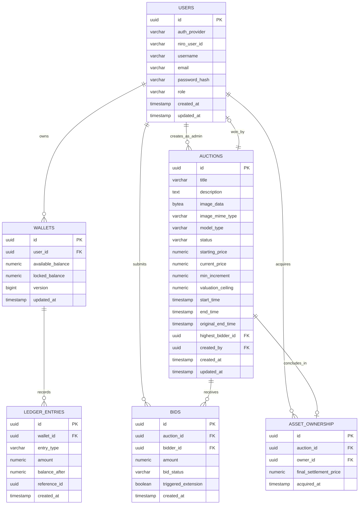

# Perancangan Skema Data (Database Schema & Cache Structure)

| Metadata | Nilai |
|---|---|
| **Dokumen** | Data Model & Storage Specifications (MVP 1 Baseline) |
| **Proyek** | Real-Time Auction & Bidding Engine |
| **Tipe Dokumen** | Desain Data & Penyimpanan (Data Design) |
| **Versi** | v0.1.0 |
| **Status** | `Draft` (Dalam Perancangan) |
| **Tanggal** | 2026-10-24 |
| **Komponen Data** | PostgreSQL 16 (Relational/Ledger) & Redis 7 (In-Memory Hot-Path) |

---

## 1. Arsitektur Penyimpanan & Alokasi Peran

Untuk memenuhi kebutuhan performa **SLA < 300 ms** dan jaminan integritas transaksi **ACID (Nol Race Condition)**, sistem menggunakan arsitektur *dual-tier storage*:

1. **Redis 7 (Hot-Path Engine & Concurrency Gate):**
   - Serialisasi penawaran lelang secara instan via Redis Lua Scripts.
   - Penyimpanan status hitung mundur waktu (*dynamic expiration timer*).
   - Penguncian agunan sementara (*fast balance reservation*).
   - Redis Pub/Sub untuk mendistribusikan event ke Server-Sent Events (SSE) Streaming Hub.
2. **PostgreSQL 16 (Authoritative Ledger & Audit Trail):**
   - Penyimpanan permanen profil pengguna, kepemilikan aset, dan riwayat penawaran (*immutable bids*).
   - Double-entry ledger untuk memastikan audit keuangan tidak bisa dimanipulasi (*tamper-proof balance history*).

---

## 2. Diagram Hubungan Antar Entitas (ERD) — PostgreSQL



---

## 3. Spesifikasi Kamus Data (PostgreSQL DDL)

### 3.1 Tabel `users`
Menyimpan identitas terverifikasi dan otorisasi hak akses.

```sql
CREATE TYPE user_role AS ENUM ('BIDDER', 'ADMIN', 'SUPERADMIN');
CREATE TYPE auth_provider AS ENUM ('NIRO', 'INTERNAL');

CREATE TABLE users (
    id UUID PRIMARY KEY DEFAULT gen_random_uuid(),
    auth_provider auth_provider NOT NULL DEFAULT 'NIRO',
    niro_user_id VARCHAR(100) NULL UNIQUE, -- ID unik dari identitas NIRO jika login via NIRO
    username VARCHAR(50) NOT NULL UNIQUE,
    email VARCHAR(100) NOT NULL UNIQUE,
    password_hash VARCHAR(255) NULL, -- Nullable jika autentikasi di-handle penuh oleh NIRO SSO
    role user_role NOT NULL DEFAULT 'BIDDER',
    created_at TIMESTAMP WITH TIME ZONE DEFAULT CURRENT_TIMESTAMP,
    updated_at TIMESTAMP WITH TIME ZONE DEFAULT CURRENT_TIMESTAMP
);

CREATE INDEX idx_users_email ON users(email);
CREATE INDEX idx_users_niro_id ON users(niro_user_id);
CREATE INDEX idx_users_role ON users(role);
```

### 3.2 Tabel `wallets`
Menyimpan saldo likuiditas bebas dan saldo yang sedang dikunci sebagai agunan.

```sql
CREATE TABLE wallets (
    id UUID PRIMARY KEY DEFAULT gen_random_uuid(),
    user_id UUID NOT NULL UNIQUE REFERENCES users(id) ON DELETE CASCADE,
    available_balance NUMERIC(15, 2) NOT NULL DEFAULT 0.00 CHECK (available_balance >= 0),
    locked_balance NUMERIC(15, 2) NOT NULL DEFAULT 0.00 CHECK (locked_balance >= 0), -- Saldo tertahan/terkunci HANYA saat ada bidding aktif
    version BIGINT NOT NULL DEFAULT 1, -- Optimistic lock support
    updated_at TIMESTAMP WITH TIME ZONE DEFAULT CURRENT_TIMESTAMP
);

CREATE INDEX idx_wallets_user ON wallets(user_id);
```

### 3.3 Tabel `ledger_entries`
Buku besar mutasi finansial (Audit Trail mutlak).

```sql
CREATE TYPE ledger_type AS ENUM (
    'INITIAL_MINIMUM_RESERVE', 
    'WALLET_TOPUP',
    'COLLATERAL_HOLD', 
    'COLLATERAL_RELEASE', 
    'AUCTION_WIN_PAYMENT'
);

CREATE TABLE ledger_entries (
    id UUID PRIMARY KEY DEFAULT gen_random_uuid(),
    wallet_id UUID NOT NULL REFERENCES wallets(id) ON DELETE RESTRICT,
    entry_type ledger_type NOT NULL,
    amount NUMERIC(15, 2) NOT NULL,
    balance_after NUMERIC(15, 2) NOT NULL,
    reference_id UUID NULL, -- ID lelang atau ID penawaran terkait
    created_at TIMESTAMP WITH TIME ZONE DEFAULT CURRENT_TIMESTAMP
);

CREATE INDEX idx_ledger_wallet ON ledger_entries(wallet_id);
```

### 3.4 Tabel `auctions`
Menyimpan konfigurasi lot lelang dan status siklus hidupnya.

```sql
CREATE TYPE auction_model AS ENUM ('UNCAPPED', 'CAPPED');
CREATE TYPE auction_status AS ENUM ('DRAFT', 'ACTIVE', 'CLOSED_AWARDED', 'SETTLED', 'EXPIRED_UNSOLD');
CREATE TYPE asset_category AS ENUM (
    'LUXURY_WATCHES',     -- e.g. Rolex, Patek Philippe, Audemars Piguet
    'DESIGNER_BAGS',      -- e.g. Hermès Birkin/Kelly, Chanel, Louis Vuitton
    'FINE_JEWELRY',       -- e.g. Cartier, Tiffany & Co., Van Cleef & Arpels
    'COLLECTIBLE_VEHICLES',-- e.g. Vintage Porsche, Ferrari, Supercars
    'RARE_MEMORABILIA'    -- e.g. Signed high-value collector items, Rare Sneaker Editions
);

CREATE TABLE auctions (
    id UUID PRIMARY KEY DEFAULT gen_random_uuid(),
    title VARCHAR(150) NOT NULL,
    category asset_category NOT NULL, -- Klasifikasi Kategori Barang Pribadi Bernilai Tinggi
    condition_grade VARCHAR(50) NOT NULL DEFAULT 'MINT', -- Kondisi: MINT, LIKE_NEW, EXCELLENT
    authenticity_guarantee VARCHAR(255) NOT NULL, -- Nomor Sertifikat Keaslian / Kelengkapan Dokumen
    description TEXT NOT NULL,
    image_data BYTEA NOT NULL, -- Disimpan sebagai binary BLOB di DB; saat di-return dikonversi menjadi Base64 Compressed string
    image_mime_type VARCHAR(50) NOT NULL DEFAULT 'image/jpeg',
    model_type auction_model NOT NULL DEFAULT 'UNCAPPED',
    status auction_status NOT NULL DEFAULT 'ACTIVE',
    starting_price NUMERIC(15, 2) NOT NULL CHECK (starting_price > 0), -- Open Bid Awal
    current_price NUMERIC(15, 2) NOT NULL CHECK (current_price >= starting_price),
    min_increment NUMERIC(15, 2) NOT NULL CHECK (min_increment > 0),
    allowed_increment_steps JSONB NOT NULL DEFAULT '[10000, 25000, 50000, 100000]'::jsonb, -- Pilihan tombol inkremental resmi
    valuation_ceiling NUMERIC(15, 2) NULL, -- Harga Maksimal (Buyout Ceiling) - Opsional. Jika ditawar langsung laku!
    anti_sniping_extension_minutes INT NULL DEFAULT 2, -- Opsi durasi perpanjangan jika terjadi >= 10 hits/detik di 2 menit akhir
    start_time TIMESTAMP WITH TIME ZONE NOT NULL,
    end_time TIMESTAMP WITH TIME ZONE NOT NULL,
    original_end_time TIMESTAMP WITH TIME ZONE NOT NULL,
    highest_bidder_id UUID NULL REFERENCES users(id) ON DELETE SET NULL,
    created_by UUID NOT NULL REFERENCES users(id) ON DELETE RESTRICT,
    created_at TIMESTAMP WITH TIME ZONE DEFAULT CURRENT_TIMESTAMP,
    updated_at TIMESTAMP WITH TIME ZONE DEFAULT CURRENT_TIMESTAMP,
    CONSTRAINT check_capped_ceiling CHECK (
        (model_type = 'CAPPED' AND valuation_ceiling IS NOT NULL AND valuation_ceiling > starting_price) OR 
        (model_type = 'UNCAPPED')
    )
);

CREATE INDEX idx_auctions_category ON auctions(category);
CREATE INDEX idx_auctions_status ON auctions(status);
CREATE INDEX idx_auctions_end_time ON auctions(end_time);
```

### 3.5 Tabel `bids`
Catatan permanen dari setiap penawaran sah yang diterima.

```sql
CREATE TYPE bid_state AS ENUM ('VALID', 'OUTBID', 'WINNING');

CREATE TABLE bids (
    id UUID PRIMARY KEY DEFAULT gen_random_uuid(),
    auction_id UUID NOT NULL REFERENCES auctions(id) ON DELETE CASCADE,
    bidder_id UUID NOT NULL REFERENCES users(id) ON DELETE RESTRICT,
    amount NUMERIC(15, 2) NOT NULL,
    bid_status bid_state NOT NULL DEFAULT 'WINNING',
    triggered_extension BOOLEAN NOT NULL DEFAULT FALSE,
    created_at TIMESTAMP WITH TIME ZONE DEFAULT CURRENT_TIMESTAMP
);

CREATE INDEX idx_bids_auction ON bids(auction_id, created_at DESC);
CREATE INDEX idx_bids_bidder ON bids(bidder_id);
```

### 3.6 Tabel `asset_ownership`
Penerbitan hak kepemilikan aset resmi kepada pemenang lelang.

```sql
CREATE TABLE asset_ownership (
    id UUID PRIMARY KEY DEFAULT gen_random_uuid(),
    auction_id UUID NOT NULL UNIQUE REFERENCES auctions(id) ON DELETE RESTRICT,
    owner_id UUID NOT NULL REFERENCES users(id) ON DELETE RESTRICT,
    final_settlement_price NUMERIC(15, 2) NOT NULL,
    acquired_at TIMESTAMP WITH TIME ZONE DEFAULT CURRENT_TIMESTAMP
);

CREATE TABLE platform_configurations (
    id UUID PRIMARY KEY DEFAULT gen_random_uuid(),
    config_key VARCHAR(100) NOT NULL UNIQUE,
    config_value JSONB NOT NULL,
    description TEXT NULL,
    updated_by UUID NULL REFERENCES users(id),
    updated_at TIMESTAMP WITH TIME ZONE DEFAULT CURRENT_TIMESTAMP
);

CREATE TABLE proxy_bids (
    id UUID PRIMARY KEY DEFAULT gen_random_uuid(),
    auction_id UUID NOT NULL REFERENCES auctions(id) ON DELETE CASCADE,
    bidder_id UUID NOT NULL REFERENCES users(id) ON DELETE CASCADE,
    max_limit NUMERIC(15, 2) NOT NULL CHECK (max_limit > 0),
    is_active BOOLEAN NOT NULL DEFAULT TRUE,
    created_at TIMESTAMP WITH TIME ZONE DEFAULT CURRENT_TIMESTAMP,
    updated_at TIMESTAMP WITH TIME ZONE DEFAULT CURRENT_TIMESTAMP,
    CONSTRAINT uq_auction_bidder_proxy UNIQUE (auction_id, bidder_id)
);

CREATE INDEX idx_proxy_bids_auction ON proxy_bids(auction_id) WHERE is_active = TRUE;
```

---

## 4. Struktur Data In-Memory & Kunci Cache (Redis)

Redis digunakan sebagai *Single Source of Truth* untuk validasi real-time dan mekanisme hitung mundur.

### 4.1 Hash: State Lot Lelang Aktif
* **Format Kunci:** `auction:{lot_id}`
* **Tipe Data:** `HASH`
* **Struktur Field:**
  ```text
  status                -> "ACTIVE"
  model_type            -> "UNCAPPED" | "CAPPED"
  current_price         -> "1200.00"
  min_increment         -> "100.00"
  valuation_ceiling     -> "5000.00" (atau "0")
  highest_bidder        -> "3fa85f64-5717-4562-b3fc-2c963f66afa6"
  end_time              -> "1792849200000" (Unix Epoch Milliseconds)
  original_end_time     -> "1792849000000"
  max_end_time          -> "1792849300000" (Original + 5 Menit Max Cap)
  ```

### 4.2 Hash: Saldo Agunan Pengguna di Memori
* **Format Kunci:** `wallet:{user_id}`
* **Tipe Data:** `HASH`
* **Struktur Field:**
  ```text
  available_balance          -> "500000.00"   (Saldo bebas yang bisa dipakai bid)
  locked_balance             -> "120000.00"   (Saldo yang sedang aktif menawar di lot lelang)
  ```

### 4.3 Sorted Set: Indeks Expirations Daemon
* **Format Kunci:** `auctions:expiry_zset`
* **Tipe Data:** `ZSET`
* **Score:** `end_time` (Unix Timestamp)
* **Member:** `{lot_id}`
* **Penggunaan:** Background daemon mengeksekusi `ZRANGEBYSCORE auctions:expiry_zset -inf (now)` setiap 1 detik untuk mengambil lot yang baru saja kedaluwarsa.

### 4.4 Distributed Lock (Settlement Protection)
* **Format Kunci:** `lock:settle:{lot_id}`
* **Tipe Data:** `STRING`
* **TTL:** `10 seconds`
* **Penggunaan:** Menghindari eksekusi rekonsiliasi ganda oleh beberapa instance server.

---

## 5. Logika Redis Lua Script (Atomic Bidding Core)

Skrip Lua berikut dijalankan secara atomik di server Redis untuk menangani penawaran manual, perpanjangan waktu anti-sniping, dan penguncian agunan dalam **< 5 milidetik**:

```lua
-- KEYS: [1] auction_key, [2] bidder_wallet_key, [3] old_bidder_wallet_key, [4] expiry_zset
-- ARGV: [1] bidder_id, [2] bid_amount, [3] now_ms, [4] old_bidder_id, [5] old_bid_amount

local auction = redis.call('HMGET', KEYS[1], 'status', 'current_price', 'min_increment', 'end_time', 'max_end_time', 'model_type', 'valuation_ceiling')
local status = auction[1]
local current_price = tonumber(auction[2])
local min_increment = tonumber(auction[3])
local end_time = tonumber(auction[4])
local max_end_time = tonumber(auction[5])
local model_type = auction[6]
local valuation_ceiling = tonumber(auction[7])

local bid_amount = tonumber(ARGV[2])
local now_ms = tonumber(ARGV[3])

-- 1. Validasi Status & Waktu
if status ~= 'ACTIVE' or now_ms >= end_time then
    return redis.error_reply("ERR_AUCTION_NOT_ACTIVE")
end

-- 2. Validasi Kenaikan Harga
if bid_amount < (current_price + min_increment) then
    return redis.error_reply("ERR_BID_TOO_LOW")
end

-- 3. Validasi Saldo Agunan Penawar Baru
local available_bal = tonumber(redis.call('HGET', KEYS[2], 'available_balance') or '0')
if available_bal < bid_amount then
    return redis.error_reply("ERR_INSUFFICIENT_COLLATERAL")
end

-- 4. Kunci Agunan Penawar Baru
redis.call('HINCRBYFLOAT', KEYS[2], 'available_balance', -bid_amount)
redis.call('HINCRBYFLOAT', KEYS[2], 'locked_balance', bid_amount)

-- Catatan: Saldo penawar sebelumnya TIDAK di-unfreeze saat outbid.
-- Seluruh dana penawar tetap berstatus locked sampai lelang diselesaikan (settled).

-- 6. Cek Anti-Sniping (Sisa waktu <= 15 detik = 15000 ms)
local time_extended = false
local new_end_time = end_time
if (end_time - now_ms) <= 15000 then
    if (end_time + 30000) <= max_end_time then
        new_end_time = end_time + 30000
        time_extended = true
        redis.call('HSET', KEYS[1], 'end_time', tostring(new_end_time))
        redis.call('ZADD', KEYS[4], new_end_time, ARGV[1]) -- Update zset expiry
    end
end

-- 7. Cek Capped Buyout
local buyout_triggered = false
if model_type == 'CAPPED' and bid_amount >= valuation_ceiling then
    buyout_triggered = true
    redis.call('HSET', KEYS[1], 'status', 'CLOSED_AWARDED')
    redis.call('ZREM', KEYS[4], ARGV[1])
end

-- 8. Simpan Penawar & Harga Baru
redis.call('HMSET', KEYS[1], 'current_price', tostring(bid_amount), 'highest_bidder', ARGV[1])

return {tostring(bid_amount), tostring(new_end_time), time_extended and 1 or 0, buyout_triggered and 1 or 0}
```
