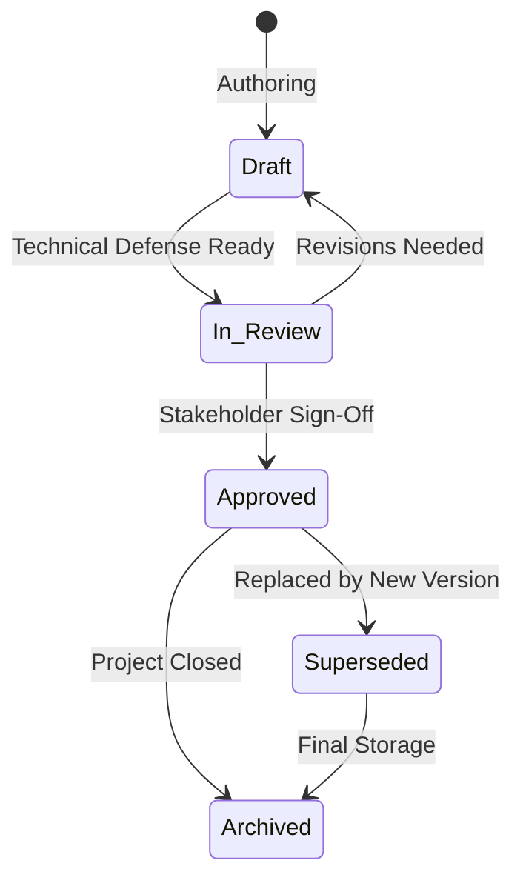

# Documentation Lifecycle Methodology

Guidelines for managing the authoring, peer review, approval, and eventual deprecation of artifacts.

---

## 1. Lifecycle Stages

* **Transition Rule:** A document transitions from `Draft` to `In Review` only when all required template sections are populated without pending placeholders.
* **Traceability Update:** When a document becomes `Superseded`, an explicit warning banner with a link to the successor must be placed immediately under the title header.
