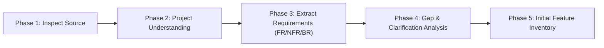

# PDF & Source Document Analysis Workflow

Standard Operating Procedure for performing initial technical analysis on incoming specifications, PDFs, or client briefs.

---

## 5-Phase Analysis Lifecycle

### Phase 1 — Inspect the Source Document
* Verify metadata: document title, dates, authors, target benchmarks, constraints.
* Assess document completeness, unreadable sections, or visual ambiguities.
* Report any limitations upfront.

### Phase 2 — Establish Project Understanding
* Sourced summary of business problem, core objectives, user personas, high-level lifecycle flows, and scope boundaries.
* Distinguish confirmed statements from inferences.

### Phase 3 — Extract & Classify Requirements
* Formulate structured tables with stable IDs:
  - `FR-XXX`: Functional Requirements
  - `NFR-XXX`: Non-Functional Requirements
  - `BR-XXX`: Business Rules & Logic Constraints
  - `IR-XXX`: Integration & Protocol Requirements
* Tag every item with explicit Status (*Confirmed*, *Ambiguous*, *Assumed*, *Proposed*).

### Phase 4 — Gap Analysis & Stakeholder Clarifications
* Identify missing contracts, parameter bounds, edge cases, and architectural uncertainties.
* Formulate concrete, actionable clarification questions with priority tags (*Critical*, *High*, *Medium*, *Low*).

### Phase 5 — Initial Feature Inventory
* Map extracted requirements into high-level system modules and discrete features (`FEAT-XXX`).
* Detail primary actors, trigger events, and expected outcomes.
* Save the deliverable into `02_Projects/<project>/02_Analysis/initial-feature-discovery.md`.
