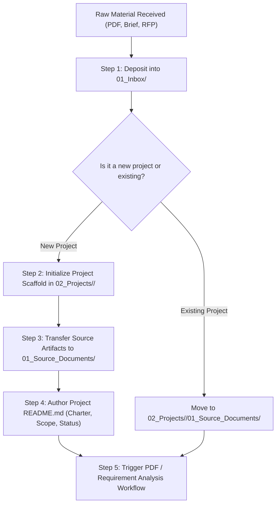

# Project Intake Workflow

This workflow guides the structured intake of a new project into the Second Brain workspace.

---

## Process Steps

### Step 1: Ingestion
Receive raw files into `01_Inbox/PDFs/` or relevant inbox subdirectories.

### Step 2: Provision Project Directory
Create directory: `02_Projects/<project-name>/` with standardized core folders (`00_Project_Overview/`, `01_Source_Documents/`, `02_Analysis/`, `03_Requirements/`, `04_Design/`, `09_Decisions/`).

### Step 3: Populate Project README
Initialize `02_Projects/<project-name>/README.md` defining project purpose, business context, active status (`Draft`), and key artifact links.
