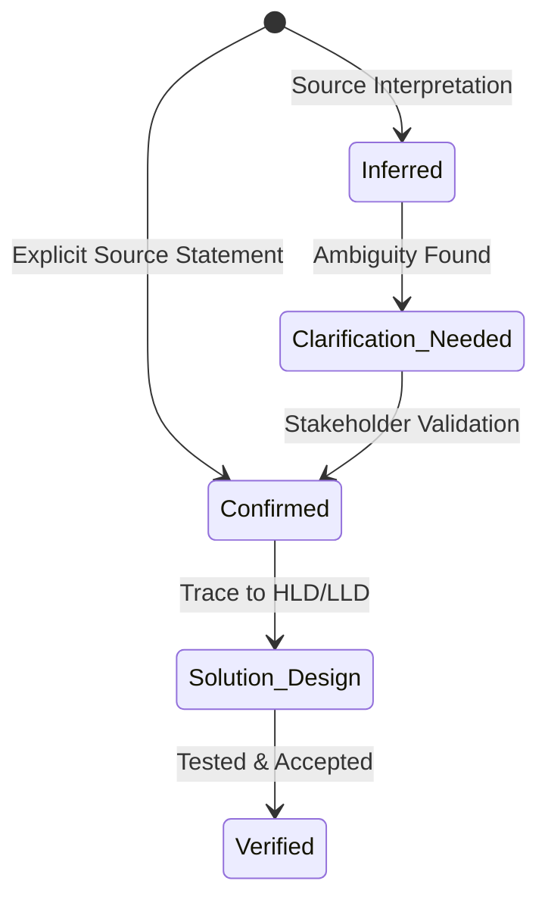

# Requirements Engineering Methodology

This document outlines the principles and lifecycle of requirements engineering within the Second Brain.

---

## 1. Classification Model
Requirements must be categorized into distinct, testable classes:
- **Functional Requirements (`FR`):** What the system must do.
- **Non-Functional Requirements (`NFR`):** Quality attributes (performance, latency, throughput, reliability, security).
- **Business Rules (`BR`):** Domain logic, regulatory constraints, and calculations independent of technical implementation.
- **Integration Requirements (`IR`):** Interfaces, protocols, payload contracts with external/internal systems.
- **Data Requirements (`DR`):** Retention, consistency, audit trails, and storage policies.

---

## 2. Requirement Lifecycle & Certainty States

* Every requirement must be linked back to its source section or stakeholder sign-off to ensure zero "phantom" requirements.
