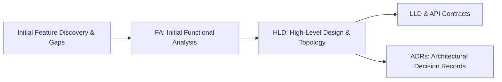

# Solution Architecture Workflow

This workflow guides the structured formulation and technical justification of solution architectures.

---

## 1. Architectural Design Principles
1. **Requirements Justification:** Every component, service, or datastore must be traceable to a functional or non-functional requirement.
2. **Trade-Off Analysis:** Present multiple viable solutions when significant trade-offs exist (e.g. In-memory vs. Distributed locks; Event sourcing vs. Relational state).
3. **Diagram Consistency:** Diagrams (Mermaid) must match text data models and endpoint contracts identically.

---

## 2. Standard Design Artifact Sequence

* **IFA (Initial Functional Analysis):** Validates scope, actors, and functional decomposition before technical commitments.
* **HLD (High-Level Design):** Defines component topology, communication streams (REST/WS), and datastore patterns.
* **LLD (Low-Level Design):** Defines internal concurrency models, class/package structures, and sequence interactions.
* **ADR (Architecture Decision Record):** Captures key trade-offs, options evaluated, and chosen path with explicit rationale.
